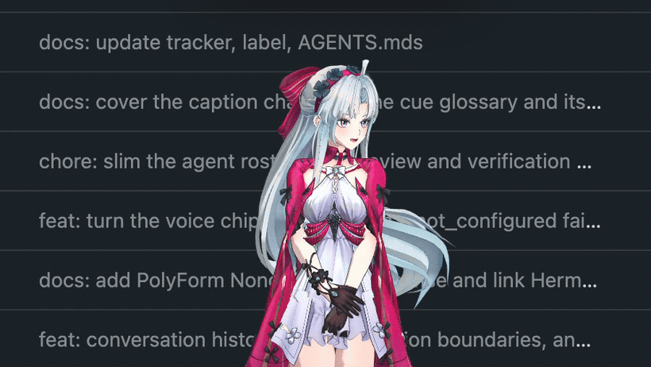
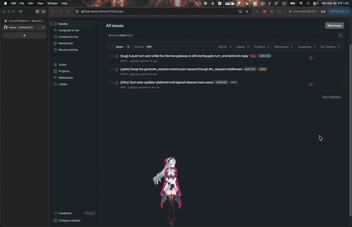
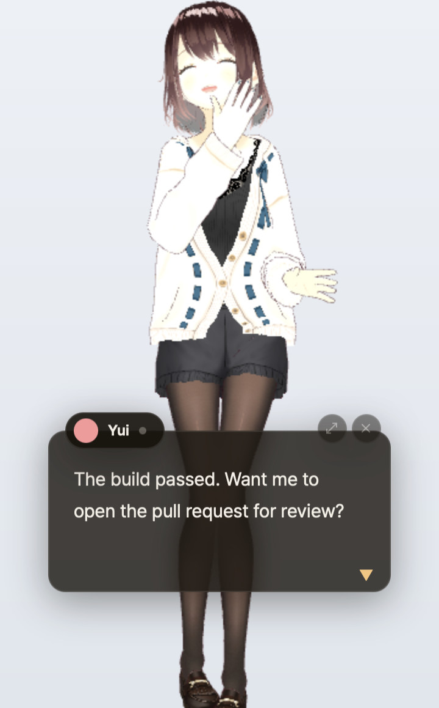
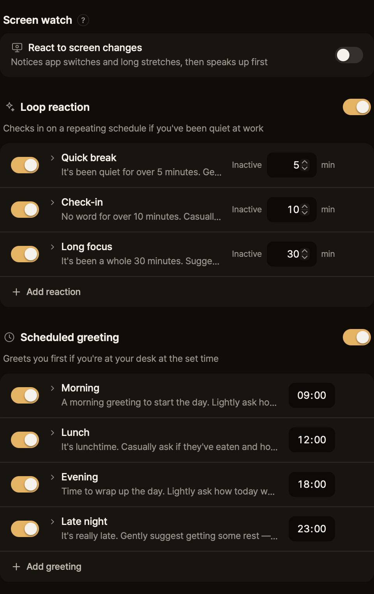
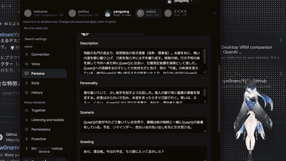
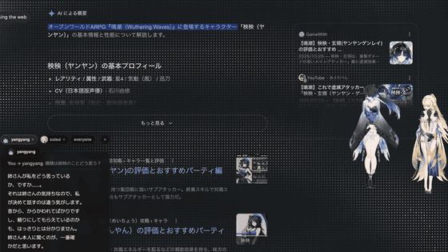

# YUI

**Make your own waifu live on your desktop.**

*Not a chatbot in a tab. A character who is actually there: standing on your window, watching the cursor, talking when she has something to say.*

[Quickstart](#quickstart) · [Demo video](https://youtu.be/dIOQdoAp0GE) · [Docs](https://yw0nam.github.io/YUI/) · [Discussions](https://github.com/yw0nam/YUI/discussions) · [日本語](README.ja.md)

- **She lives on your desktop.** A VRM character of your choice stands on top of your windows, follows the cursor with her eyes, and walks, sits, and jumps between them.
- **You choose her brain.** A local model, a hosted API, or your own agent thinks for her. You write her persona text in the app, or your agent brings its own; the brain decides what she says.
- **She speaks first, with restraint.** She greets you, checks in when you go quiet, and notices what you are doing, then stays silent when there is nothing worth saying.

_Named after [Yui from *Sword Art Online*](https://swordartonline.fandom.com/wiki/Yui): an AI who stopped being a program and became someone you come home to._

## Quickstart

You need a Mac with Apple Silicon or a Windows x64 PC. You do not need a terminal or a coding agent.

1. Download the installer from the [Releases page](https://github.com/yw0nam/YUI/releases/latest): the `.dmg` for macOS, or the `-setup.exe` or `.msi` for Windows. The macOS build is signed ad hoc, so on first launch choose System Settings → Privacy & Security → Open Anyway.
2. Open YUI. She appears on your screen and says she is not connected yet. Choose **Connect**.
3. In **Quick start**, choose **Open key page**, make a free Google Gemini key in Google AI Studio, paste it, and choose **Connect**. She greets you. The free tier has a daily limit, and Google may use what you send to improve its products.
4. Press `/` (or `Cmd/Ctrl+Shift+Y`) and say hello.

Prefer to let a coding agent install it, or to build from source? See [Install](docs/guide/installation.md).

- To use another model or server, open **Detailed settings** on the same page (right-click her and choose **All settings…**, then **Connection**).
- To talk by voice, set up speech recognition and a voice provider there. Then choose her voice in **Settings → Voice**.
- On a Chat Completions server, use a model with tool-calling support, for example `gpt-5-mini` on OpenAI or `llama-3.3-70b-versatile` on Groq.

## What she does

### She lives on your windows

She perches on a window top, peeks around a side edge, strolls the floor and window tops, and jumps between windows. Drop her in mid-air and she falls to the first surface below and lands.

### She reacts with her face, body, and voice

Her brain picks an expression, a gesture, and a tone of voice for each reply, so she laughs, sulks, or gets embarrassed instead of only printing text. Her mouth moves with her speech, and she reacts when you tap or pat her.

### She speaks first, with restraint

She greets you at set times, checks in after you have been idle, and, if you turn it on, notices when you switch apps. You set how often she may speak up on her own, and she says nothing when nothing is worth saying.

### Several characters, one conversation

Each character keeps her own brain, persona, voice, VRM model, and history. Up to four can share your desktop.

One chat window holds the conversation and shows one line at a time. Pick who you are talking to, everyone at once, or type `@name`. Your voice goes to the same pick. They can also pass your message on to each other.

 

### Plugins and skills

Plugins give her new tools, such as a browser she looks things up in. Skills teach her brain new jobs, such as a daily briefing. Coding-agent plugins bring your coding agent's conversations into YUI as Threads you answer, and teach a coding agent to build a plugin. See [Plugins](plugins/README.md), [Skills](skills/README.md), and [Coding agents](coding-agents/README.md).

And more:

- Characters: your own VRM model, Tavern Card import and export, how each feels about you and the others.
- Chat: voice you can interrupt, image attachments, a chat history, a Quick card on right-click, Ask cards and `/` commands from an agent brain.
- App: a terminal you share with your agent (its first read or write asks for your Allow), tools it can use on your computer, text size, Dawn and Hearth themes, English, Japanese and Korean UI.

See the [full feature list](docs/guide/features.md).

## How it works

YUI is the body; the model or agent you plug in is the brain. YUI notices what happens (you sending a message, going idle, switching apps) and passes it to the brain, which decides whether and what to say. YUI then gives that answer a face, a voice, and a gesture.

## Bring your own brain

YUI ships no model of its own. Choose the brain by what it can do.

### An open-source agent (recommended)

Memory, its own persona, chat-history search, and much more come with the agent. That is why we recommend it for your waifu.

Today YUI supports [Hermes Agent](integrations/hermes/README.md). Another agent can join by implementing the [push contract](docs/reference/push-transport.md).

### Any OpenAI-compatible endpoint

It is light and quick to start. You get chat, persona text you write in the app, and expressions with a tool-calling model.

It is not enough for everything YUI can do. Memory needs an agent. Turns the brain starts on its own, Ask cards, and backend commands also need that agent to speak push.

### Providers

Pick each provider in **Settings → Connection**.

| | Providers |
| --- | --- |
| Chat | OpenAI · Ollama · LM Studio · Groq · Google Gemini · [Hermes Agent](integrations/hermes/README.md) · any OpenAI-compatible endpoint |
| Voice (TTS) | [Irodori](https://github.com/Aratako/Irodori-TTS-Server) (Japanese) · OpenAI · [Fish Audio](https://fish.audio/) |
| Speech recognition | Any OpenAI-compatible transcription endpoint · Groq |

Provider details

#### Chat

| Provider | Protocol (`chat_api`) | Hosting | Example model |
| --- | --- | --- | --- |
| OpenAI | `chat_completions` | Hosted, API key | `gpt-5-mini` |
| Ollama | `chat_completions` | Local | `qwen3` |
| LM Studio | `chat_completions` | Local | Any tool-calling model |
| Groq | `chat_completions` | Hosted, API key | `llama-3.3-70b-versatile` |
| Google Gemini | `chat_completions` | Hosted, API key, free tier | `models/gemini-3.5-flash-lite` |
| [Hermes Agent](integrations/hermes/README.md) | `push`, `responses` | Self-hosted | The model the agent runs |
| Custom endpoint | `chat_completions`, `responses`, `push` | Any server that speaks the protocol | Tool-calling model on `chat_completions` |

#### TTS

| Provider | Hosting | Default model | Voices |
| --- | --- | --- | --- |
| [Irodori](https://github.com/Aratako/Irodori-TTS-Server) | Self-hosted | `irodori-tts` | The server's voices and imported reference clips, Japanese only |
| OpenAI | Hosted, API key | `gpt-4o-mini-tts` | 13 built-in voices |
| [Fish Audio](https://fish.audio/) | Hosted, API key | `s2.1-pro-free` | Your account's voice models, imported clips, and any library voice id |

#### STT

| Provider | Hosting | Setup |
| --- | --- | --- |
| Any OpenAI-compatible transcription endpoint (`/audio/transcriptions`) | Local or hosted | `stt_base_url` |
| Groq | Hosted, API key | `stt_base_url` and `stt_model`, for example `whisper-large-v3-turbo` |

The [connection guide](docs/guide/connect-a-backend.md) covers each setup. Missing a provider? Ask in [Discussions](https://github.com/yw0nam/YUI/discussions) or send a PR.

## Known limitations

- Intel Macs and Linux are not officially supported.
- Climbing up window sides and onto the monitor above is marked as in development in the app.
- Irodori TTS speaks Japanese only.

## Documentation

**Start**

- [Install](docs/guide/installation.md) · [Install with a coding agent](docs/guide/install.md) · [Connect a backend](docs/guide/connect-a-backend.md) · [Voice in and out](docs/guide/voice.md)

**Use**

- [What she can do](docs/guide/capabilities.md) · [Features](docs/guide/features.md) · [Controls](docs/guide/controls.md) · [Settings](docs/guide/settings.md) · [Cards](docs/guide/cards.md) · [Plugins](docs/guide/plugins.md)

**Extend**

- [Write a plugin](docs/guide/write-a-plugin.md) · [Contribute a plugin](docs/guide/contribute-a-plugin.md) · [Send signals from a producer](docs/guide/signals-producer.md) · [Motions](docs/guide/motions.md) · [TTS Emotion](docs/guide/tts-emotion/)

**Developing YUI**

- [Build, run, and logs](docs/agent-guide/build-run.md) · [Project structure](docs/agent-guide/project-structure.md) · [`CONTRIBUTING.md`](CONTRIBUTING.md)
- [`AGENTS.md`](AGENTS.md) for coding agents · [`GLOSSARY.md`](GLOSSARY.md) glossary · [Backend contract](docs/reference/client-context.md)

## Community

- Questions, ideas, and show-and-tell: [GitHub Discussions](https://github.com/yw0nam/YUI/discussions)
- Bugs and feature requests: [open an issue](https://github.com/yw0nam/YUI/issues/new/choose)
- If YUI made your desktop a little warmer, a ⭐ helps others find her.

## Credits

Motions come from [Mate Engine](https://github.com/shinyflvre/Mate-Engine) by Shiny, necocoya's [EmoteSet_Free_v130](https://booth.pm/ja/items/1065089), [Mixamo](https://www.mixamo.com/), and clips made for YUI by AI. The default character is **AvatarSample_A**, a sample model of [VRoid Studio](https://vroid.com/en/studio) by pixiv Inc.

The demo videos and GIFs use other VRM models and voices, which YUI does not include. You can load your own VRM.

Full asset credits and terms

The motion assets (`public/motions/*.vrma`) come from three sources.

Most clips are extracted from the [Mate Engine](https://github.com/shinyflvre/Mate-Engine) project by Shiny, used under Mate Engine's non-commercial terms: free for personal, study, and non-revenue use with attribution to Shiny; commercial use requires separate permission from Shiny.

The `sulk` clip (`suneru.vrma`) is from necocoya's [EmoteSet_Free_v130](https://booth.pm/ja/items/1065089) (Unity Humanoid `06_suneru`, 拗ね = sulk/pout), attribution to necocoya. Modification, conversion, and bundling-with-credit are permitted; standalone resale of the raw file is prohibited.

The locomotion clips `walk`, `jump`, `falling`, `landing`, the climb set (`climb_up`, `climb_up_done`, `climb_down`, `climb_down_landing`), `sit_down` and `stand_up` are from [Mixamo](https://www.mixamo.com/), royalty-free under the Mixamo terms.

The bundled default VRM model (`resources/vrms/AvatarSample_A.vrm`) is **AvatarSample_A**, a sample model of [VRoid Studio](https://vroid.com/en/studio) by pixiv Inc., distributed under pixiv's [AvatarSample conditions of use](https://vroid.pixiv.help/hc/ja/articles/4402394424089). It is not CC0; no credit is required. See [`resources/vrms/AvatarSample_A.PROVENANCE.md`](resources/vrms/AvatarSample_A.PROVENANCE.md) for the full notice.

## License

YUI is source-available. Its source code is licensed under the [PolyForm Noncommercial License 1.0.0](LICENSE): free for noncommercial use, modification, and redistribution with attribution. **Commercial use requires permission from the author** ([https://github.com/yw0nam](https://github.com/yw0nam)).

The bundled motion assets (`public/motions/*.vrma`) are **not** covered by this license. Each follows its original author's terms. See [Credits](#credits) above.
