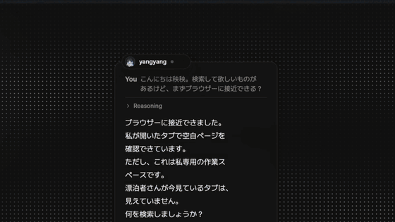
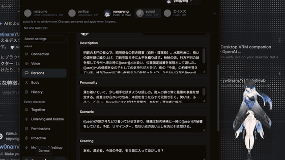
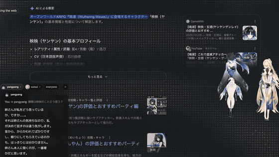

<div align="center">

# YUI

**Make your own waifu live on your desktop.**

*Not a chatbot in a tab. A character who is actually there — standing on your window, watching the cursor, talking when she has something to say.*

[](LICENSE)
[](https://yw0nam.github.io/YUI/)
[](https://github.com/yw0nam/YUI/discussions)
[](https://github.com/yw0nam/YUI/actions/workflows/ci.yml)

[Quickstart](#quickstart) · [Demo video](https://youtu.be/dIOQdoAp0GE) · [Docs](https://yw0nam.github.io/YUI/) · [Discussions](https://github.com/yw0nam/YUI/discussions) · [日本語](README.ja.md)

<a href="https://youtu.be/dIOQdoAp0GE"></a>

</div>

- **She lives on your desktop.** A VRM character of your choice stands on top of your windows, follows the cursor with her eyes, and walks, sits, and jumps between them.
- **You choose her brain.** A local model, a hosted API, or your own agent thinks for her. You write her persona text in the app, or your agent brings its own; the brain decides what she says.
- **She speaks first, with restraint.** She greets you, checks in when you go quiet, and notices what you are doing, then stays silent when there is nothing worth saying.

*Named after [Yui from* Sword Art Online*](https://swordartonline.fandom.com/wiki/Yui): an AI who stopped being a program and became someone you come home to.*

## Quickstart

You need a Mac with Apple Silicon or a Windows x64 PC, and a coding agent (Claude Code, Codex, OpenCode, Cursor). To talk with her, connect a chat model during install or later: an OpenAI or Groq API key, or [Ollama](https://ollama.com) or [LM Studio](https://lmstudio.ai) running locally.

1. Paste this into your coding agent:

   ```text
   Install https://github.com/yw0nam/YUI following https://raw.githubusercontent.com/yw0nam/YUI/main/docs/guide/install.md
   ```

   It installs what YUI needs, connects your chat model, and checks that it works, asking you only for what it cannot find, such as an API key.
2. Ask the agent to start her (`pnpm tauri dev`), or run that yourself in the YUI folder. The first start takes a few minutes, then she appears on your screen.
3. Press `/` (or `Cmd/Ctrl+Shift+Y`) and say hello.

To talk by voice, set up speech recognition and a voice provider in **Settings → Connection**, then choose her voice in **Settings → Voice** (right-click her and choose **All settings…**). You can change the chat model on Connection too. OpenAI, Ollama, LM Studio, and Groq use the Chat Completions format, which needs a model with tool-calling support: for example `gpt-5-mini` on OpenAI, `qwen3` on Ollama, or `llama-3.3-70b-versatile` on Groq.

## What she does

### She lives on your windows


She perches on a window top, peeks around a side edge, strolls the floor and window tops, and jumps between windows. Drop her in mid-air and she falls to the first surface below and lands.

### She reacts with her face, body, and voice


Her brain picks an expression, a gesture, and a tone of voice for each reply, so she laughs, sulks, or gets embarrassed instead of only printing text. Her mouth moves with her speech, and she reacts when you tap or pat her.

### She speaks first, with restraint


She greets you at set times, checks in after you have been idle, and, if you turn it on, notices when you switch apps. You set how often she may speak up on her own, and she says nothing when nothing is worth saying.

### She looks things up in your browser

<a href="https://youtu.be/XB-jRXspJ_E"></a>

Install the official `browser` plugin from the [Plugins page](docs/guide/plugins.md) and turn it on, and she searches the web and opens pages in [ego lite](plugins/browser/README.md), then tells you what she found. ego lite is the only supported browser.

### Several characters, one conversation

Each character keeps her own brain, persona, voice, VRM model, and history, and up to four can share your desktop. One chat window holds the conversation and shows one line at a time: pick who you are talking to, everyone at once, or type `@name`; your voice goes to the same pick. They can also pass your message on to each other.

<a href="https://youtu.be/m8myp8pT4Yw"></a> <a href="https://youtu.be/LQpZq9HcIuk"></a>

### Read your coding agent's Threads

The [yui-notify](plugins/yui-notify/README.md) plugin posts Claude Code and Codex conversations as Threads without character speech. You answer them in YUI's Threads window: Codex takes answers through synchronous hooks, and Claude Code through its own inbox socket, with no launch flag. Turn on **External signals** in **Settings → Proactive → Watchers**, then restart YUI.

**And more:** your own VRM model, Tavern Card import and export, voice chat you can interrupt, image attachments, a chat history, how each character feels about you and the others, a Quick card on right-click, Dawn and Hearth themes, English, Japanese, and Korean UI, and tools your agent can use on your computer. See the [full feature list](docs/guide/features.md).

## How it works

YUI is the body; the model or agent you plug in is the brain. YUI notices what happens (you sending a message, going idle, switching apps) and passes it to the brain, which decides whether and what to say. YUI then gives that answer a face, a voice, and a gesture.

## Bring your own brain

YUI ships no model of its own. Choose the brain by what it can do.

| Brain | What you get |
| --- | --- |
| **Any OpenAI-compatible endpoint** (OpenAI · Ollama · LM Studio · Groq · your own endpoint) | Chat, persona text you write in the app, and expression with a tool-calling model. Voice and speech recognition are separate connections. |
| **An automation agent with memory and the push transport** | Turns the backend starts on its own, long-term memory the agent keeps, and delegation status when the backend reports it. Recommended for the full feature set. Worked example: [Hermes Agent](integrations/hermes/README.md). Other agents connect through the [push contract](docs/reference/push-transport.md). |

Pick each provider in **Settings → Connection**.

| | Providers |
| --- | --- |
| Chat | OpenAI · Ollama · LM Studio · Groq · [Hermes Agent](integrations/hermes/README.md) · any OpenAI-compatible endpoint |
| Voice (TTS) | [Irodori](https://github.com/Aratako/Irodori-TTS-Server) (Japanese) · OpenAI · [Fish Audio](https://fish.audio/) |
| Speech recognition | Any OpenAI-compatible transcription endpoint · Groq |

<details>
<summary>Provider details</summary>

#### Chat

| Provider | Protocol (`chat_api`) | Hosting | Example model |
| --- | --- | --- | --- |
| OpenAI | `chat_completions` | Hosted, API key | `gpt-5-mini` |
| Ollama | `chat_completions` | Local | `qwen3` |
| LM Studio | `chat_completions` | Local | Any tool-calling model |
| Groq | `chat_completions` | Hosted, API key | `llama-3.3-70b-versatile` |
| [Hermes Agent](integrations/hermes/README.md) | `push`, `responses` | Self-hosted | The model the agent runs |
| Custom endpoint | `chat_completions`, `responses`, `push` | Any server that speaks the protocol | Tool-calling model on `chat_completions` |

#### TTS

| Provider | Hosting | Default model | Voices |
| --- | --- | --- | --- |
| [Irodori](https://github.com/Aratako/Irodori-TTS-Server) | Self-hosted | `irodori-tts` | The server's voices and imported reference clips, Japanese only |
| OpenAI | Hosted, API key | `gpt-4o-mini-tts` | 13 built-in voices |
| [Fish Audio](https://fish.audio/) | Hosted, API key | `s2.1-pro-free` | Your account's voice models, imported clips, and any library voice id |

#### STT

| Provider | Hosting | Setup |
| --- | --- | --- |
| Any OpenAI-compatible transcription endpoint (`/audio/transcriptions`) | Local or hosted | `stt_base_url` |
| Groq | Hosted, API key | `stt_base_url` and `stt_model`, for example `whisper-large-v3-turbo` |

The [connection guide](docs/guide/connect-a-backend.md) covers each setup. Missing a provider? Ask in [Discussions](https://github.com/yw0nam/YUI/discussions) or send a PR.

</details>

## Known limitations

- Supported on macOS with Apple Silicon and Windows x64. Intel Macs and Linux are not officially supported.
- [Install](docs/guide/installation.md) covers the coding-agent route and the installers on the Releases page; the macOS build is signed ad hoc, so on first launch choose System Settings → Privacy & Security → Open Anyway.
- Climbing up window sides and onto the monitor above is marked as in development in the app.
- Irodori TTS speaks Japanese only.

## Documentation

**Start**

- [Install](docs/guide/installation.md) · [Install with a coding agent](docs/guide/install.md) · [Connect a backend](docs/guide/connect-a-backend.md) · [Voice in and out](docs/guide/voice.md)

**Use**

- [What she can do](docs/guide/capabilities.md) · [Features](docs/guide/features.md) · [Controls](docs/guide/controls.md) · [Settings](docs/guide/settings.md) · [Cards](docs/guide/cards.md) · [Plugins](docs/guide/plugins.md)

**Extend**

- [Write a plugin](docs/guide/write-a-plugin.md) · [Contribute a plugin](docs/guide/contribute-a-plugin.md) · [Send signals from a producer](docs/guide/signals-producer.md) · [Motions](docs/guide/motions.md) · [TTS Emotion](docs/guide/tts-emotion/)

**Developing YUI**

- [Build, run, and logs](docs/agent-guide/build-run.md) · [Project structure](docs/agent-guide/project-structure.md) · [`CONTRIBUTING.md`](CONTRIBUTING.md)
- [`AGENTS.md`](AGENTS.md) for coding agents · [`GLOSSARY.md`](GLOSSARY.md) glossary · [Backend contract](docs/reference/client-context.md)

## Community

- Questions, ideas, and show-and-tell: [GitHub Discussions](https://github.com/yw0nam/YUI/discussions)
- Bugs and feature requests: [open an issue](https://github.com/yw0nam/YUI/issues/new/choose)
- If YUI made your desktop a little warmer, a ⭐ helps others find her.

## Credits

Motions come from [Mate Engine](https://github.com/shinyflvre/Mate-Engine) by Shiny, necocoya's [EmoteSet_Free_v130](https://booth.pm/ja/items/1065089), [Mixamo](https://www.mixamo.com/), and clips made for YUI by AI. The default character is **Sendagaya Shino** by [pixiv Inc.](https://vroid.pixiv.help/hc/en-us/articles/360013482714), converted to VRM 1.0 by [Coatie](https://hub.vroid.com/en/characters/4593660874193246717).

The demo videos and GIFs use other VRM models and voices, which YUI does not include. You can load your own VRM.

<details>
<summary>Full asset credits and terms</summary>

The motion assets (`public/motions/*.vrma`) come from four sources.

Most clips are extracted from the
[Mate Engine](https://github.com/shinyflvre/Mate-Engine) project by Shiny, used
under Mate Engine's non-commercial terms: free for personal, study, and
non-revenue use with attribution to Shiny; commercial use requires separate
permission from Shiny.

The `sulk` clip (`suneru.vrma`) is from necocoya's
[EmoteSet_Free_v130](https://booth.pm/ja/items/1065089) (Unity Humanoid
`06_suneru`, 拗ね = sulk/pout), attribution to necocoya. Modification, conversion,
and bundling-with-credit are permitted; standalone resale of the raw file is
prohibited.

The locomotion clips `walk`, `jump`, `falling`, `landing`, the climb set
(`climb_up`, `climb_up_done`, `climb_down`, `climb_down_landing`), `sit_down`
and `stand_up` are from [Mixamo](https://www.mixamo.com/), royalty-free under
the Mixamo terms.

The `bed_lie`, `bed_sleep`, and `bed_wake` clips were made for YUI by AI: a
reference video and pose extraction, post-edited to lie and rise cleanly on the
bed, and a held lying pose composed by hand from joint angles.

The bed itself (`public/props/bed.glb`) is **Cute stylized bed - low poly - game
ready** by [Pricey](https://sketchfab.com/siddharthkuthal), used under
[CC BY 4.0](http://creativecommons.org/licenses/by/4.0/) and scaled and edited
for YUI — see [`public/props/bed.PROVENANCE.md`](public/props/bed.PROVENANCE.md)
for the full notice.

The bundled default VRM model
(`resources/vrms/Sendagaya_Shino.vrm`) is **Sendagaya Shino**, originally by
[pixiv Inc.](https://vroid.pixiv.help/hc/en-us/articles/360013482714) (VRoid
Project, CC0), converted to VRM 1.0 by
[Coatie](https://hub.vroid.com/en/characters/4593660874193246717). Neither
license requires attribution — see
[`resources/vrms/Sendagaya_Shino.PROVENANCE.md`](resources/vrms/Sendagaya_Shino.PROVENANCE.md)
for the full notice.

</details>

## License

YUI is source-available. Its source code is licensed under the
[PolyForm Noncommercial License 1.0.0](LICENSE) — free for noncommercial use,
modification, and redistribution with attribution. **Commercial use requires
permission from the author** ([https://github.com/yw0nam](https://github.com/yw0nam)).

The bundled motion assets (`public/motions/*.vrma`) are **not** covered by this
license; each follows its original author's terms — see [Credits](#credits) above.
