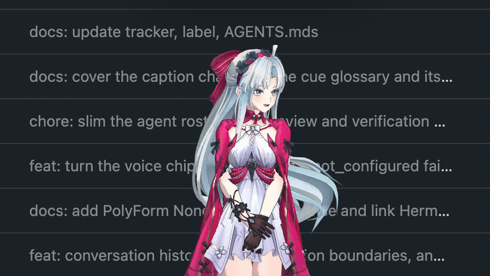
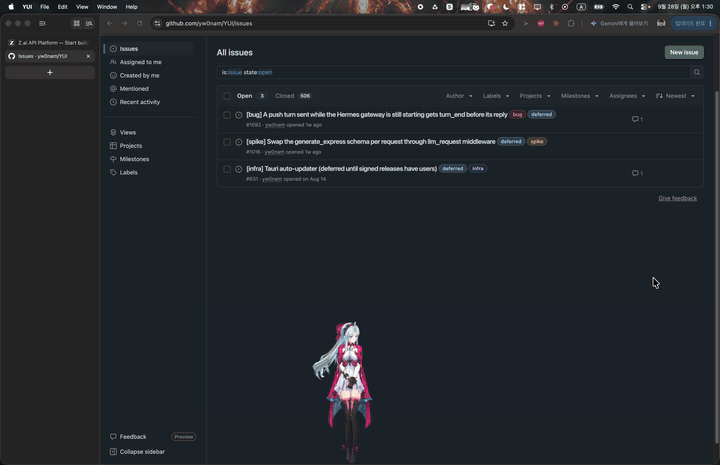
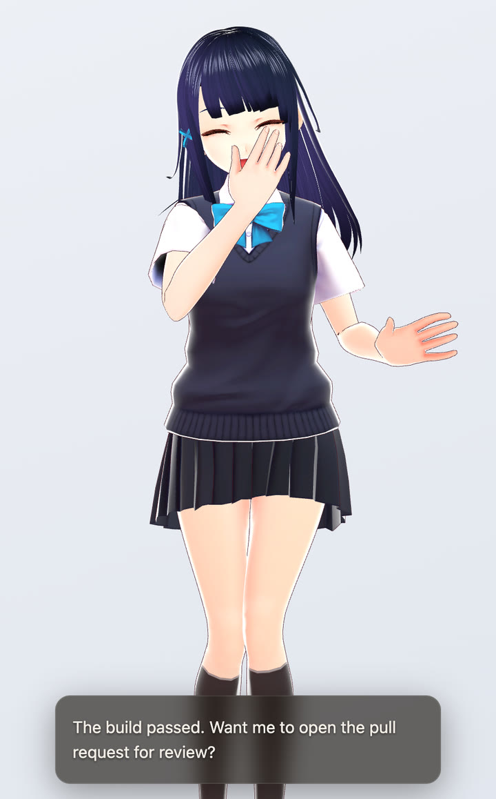
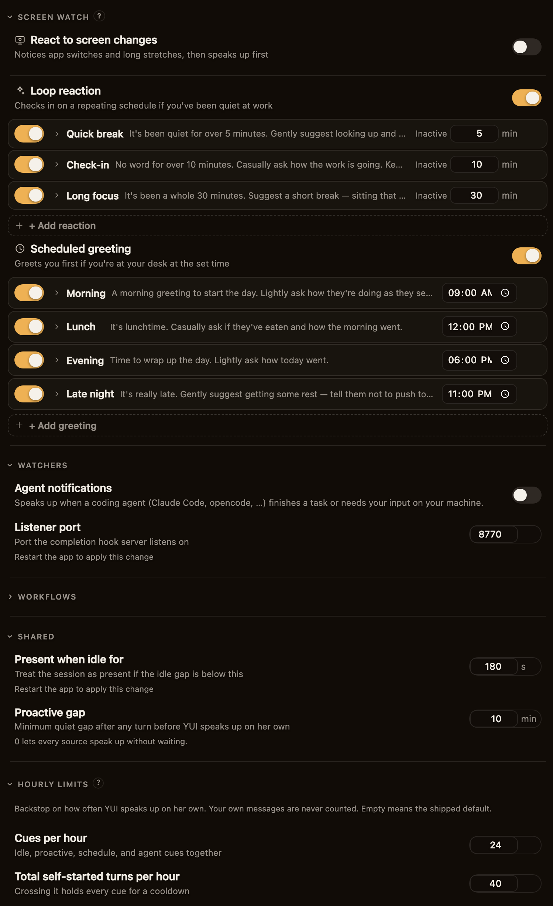

<div align="center">

# YUI

**Make your own waifu live on your desktop.**

*Not a chatbot in a tab. A character who is actually there — standing on your window, watching the cursor, talking when she has something to say.*

[](LICENSE)
[](https://yw0nam.github.io/YUI/)
[](https://github.com/yw0nam/YUI/discussions)
[](https://github.com/yw0nam/YUI/actions/workflows/ci.yml)

[Quickstart](#quickstart) · [Demo video](https://youtu.be/dIOQdoAp0GE) · [Docs](https://yw0nam.github.io/YUI/) · [Discussions](https://github.com/yw0nam/YUI/discussions) · [日本語](README.ja.md)

<a href="https://youtu.be/dIOQdoAp0GE"></a>

</div>

- **She lives on your desktop.** A VRM character of your choice stands on top of your windows, follows the cursor with her eyes, and walks, sits, and jumps between them.
- **You pick her mind.** Plug in a local model, a hosted API, or your own agent. She is as smart and as *yours* as what you connect.
- **She speaks first, with restraint.** She greets you, checks in when you go quiet, and notices what you are doing, then stays silent when there is nothing worth saying.

*Named after [Yui from* Sword Art Online*](https://swordartonline.fandom.com/wiki/Yui): an AI who stopped being a program and became someone you come home to.*

## Quickstart

You need a Mac with Apple Silicon or a Windows x64 PC, a coding agent (Claude Code, Codex, OpenCode, Cursor), and a chat model: an OpenAI or Groq API key, or [Ollama](https://ollama.com) or [LM Studio](https://lmstudio.ai) running locally.

1. Paste this into your coding agent:

   ```text
   Install https://github.com/yw0nam/YUI following https://raw.githubusercontent.com/yw0nam/YUI/main/docs/guide/install.md
   ```

   It installs the tools, connects the chat model you name, and checks that the model works with YUI.
2. Start her with `pnpm tauri dev` in the folder the agent set up. The first start takes a few minutes, then she appears on your screen.
3. Press `/` (or `Cmd/Ctrl+Shift+Y`) and say hello.

To change the model later, right-click her and open **Settings → Connection**. The model has to support tool calling: for example `gpt-5-mini` on OpenAI, `qwen3` on Ollama, or `llama-3.3-70b-versatile` on Groq.

## What she does

### She lives on your windows



She perches on a window top, peeks around a side edge, strolls the floor and window tops, and jumps between windows. Drop her in mid-air and she falls to the first surface below and lands.

### She reacts with her face, body, and voice



Your backend picks an expression, a gesture, and a tone of voice for each reply, so she laughs, sulks, or gets embarrassed instead of only printing text. Her mouth moves with her speech, and she reacts when you tap or pat her.

### She speaks first, with restraint



She greets you at set times, checks in after you have been idle, and can notice when you switch apps. Hourly limits and a quiet gap keep her from talking too much, and she says nothing when nothing is worth saying.

**And more:** voice chat you can interrupt, image attachments, a chat history, English, Japanese, and Korean UI, and tools your agent can use on your computer. See the [full feature list](docs/guide/features.md).

## Bring your own brain

YUI ships no model of its own. Pick each provider in **Settings → Connection**.

| | Providers |
| --- | --- |
| Chat | OpenAI · Ollama · LM Studio · Groq · [Hermes Agent](integrations/hermes/README.md) · any OpenAI-compatible endpoint |
| Voice (TTS) | [Irodori](https://github.com/Aratako/Irodori-TTS-Server) (Japanese) · OpenAI · [Fish Audio](https://fish.audio/) |
| Speech recognition | Any OpenAI-compatible transcription endpoint · Groq |

<details>
<summary>Provider details</summary>

#### Chat

| Provider | Protocol (`chat_api`) | Hosting | Example model |
| --- | --- | --- | --- |
| OpenAI | `chat_completions` | Hosted, API key | `gpt-5-mini` |
| Ollama | `chat_completions` | Local | `qwen3` |
| LM Studio | `chat_completions` | Local | Any tool-calling model |
| Groq | `chat_completions` | Hosted, API key | `llama-3.3-70b-versatile` |
| [Hermes Agent](integrations/hermes/README.md) | `push`, `responses` | Self-hosted | The model the agent runs |
| Custom endpoint | `chat_completions`, `responses`, `push` | Any server that speaks the protocol | Tool-calling model on `chat_completions` |

#### TTS

| Provider | Hosting | Default model | Voices |
| --- | --- | --- | --- |
| [Irodori](https://github.com/Aratako/Irodori-TTS-Server) | Self-hosted | `irodori-tts` | The server's voices and imported reference clips, Japanese only |
| OpenAI | Hosted, API key | `gpt-4o-mini-tts` | 13 built-in voices |
| [Fish Audio](https://fish.audio/) | Hosted, API key | `s2.1-pro-free` | Your account's voice models, imported clips, and any library voice id |

#### STT

| Provider | Hosting | Setup |
| --- | --- | --- |
| Any OpenAI-compatible transcription endpoint (`/audio/transcriptions`) | Local or hosted | `stt_base_url` |
| Groq | Hosted, API key | `stt_base_url` and `stt_model`, for example `whisper-large-v3-turbo` |

The [wiring guide](docs/guide/getting-started.md) covers each setup. Missing a provider? Ask in [Discussions](https://github.com/yw0nam/YUI/discussions) or send a PR.

</details>

## How it works

YUI is the body; your backend is the mind. YUI notices moments worth reacting to (you typing, going idle, switching apps) and hands them to the backend, which decides whether and what to say. YUI then gives that answer a face, a voice, and a gesture.

## Known limitations

- Supported on macOS with Apple Silicon and Windows x64. Intel Macs and Linux are not officially supported.
- The installers on the Releases page are early and unsigned; installing with a coding agent is the supported path.
- Climbing up window sides and onto the monitor above is marked as in development in the app.
- Irodori TTS speaks Japanese only.

## Documentation

**Using YUI**

- [Feature list](docs/guide/features.md) · [Controls](docs/guide/controls.md) · [What she can do](docs/guide/capabilities.md)
- [Install with a coding agent](docs/guide/install.md) · [Wiring guide](docs/guide/getting-started.md): chat, voice, your own VRM

**Developing YUI**

- [Build, run, and logs](docs/agent-guide/build-run.md) · [Project structure](docs/agent-guide/project-structure.md) · [`CONTRIBUTING.md`](CONTRIBUTING.md)
- [`AGENTS.md`](AGENTS.md) for coding agents · [`CONTEXT.md`](CONTEXT.md) glossary · [Backend contract](docs/reference/client-context.md)

## Community

- Questions, ideas, and show-and-tell: [GitHub Discussions](https://github.com/yw0nam/YUI/discussions)
- Bugs and feature requests: [open an issue](https://github.com/yw0nam/YUI/issues/new/choose)
- If YUI made your desktop a little warmer, a ⭐ helps others find her.

## Credits

Motions come from [Mate Engine](https://github.com/shinyflvre/Mate-Engine) by Shiny, necocoya's [EmoteSet_Free_v130](https://booth.pm/ja/items/1065089), and [Mixamo](https://www.mixamo.com/). The default character is **Sendagaya Shino** by [pixiv Inc.](https://vroid.pixiv.help/hc/en-us/articles/360013482714), converted to VRM 1.0 by [Coatie](https://hub.vroid.com/en/characters/4593660874193246717).

<details>
<summary>Full asset credits and terms</summary>

The motion assets (`public/motions/*.vrma`) come from three sources.

Most clips are extracted from the
[Mate Engine](https://github.com/shinyflvre/Mate-Engine) project by Shiny, used
under Mate Engine's non-commercial terms: free for personal, study, and
non-revenue use with attribution to Shiny; commercial use requires separate
permission from Shiny.

The `sulk` clip (`suneru.vrma`) is from necocoya's
[EmoteSet_Free_v130](https://booth.pm/ja/items/1065089) (Unity Humanoid
`06_suneru`, 拗ね = sulk/pout), attribution to necocoya. Modification, conversion,
and bundling-with-credit are permitted; standalone resale of the raw file is
prohibited.

The locomotion clips `walk`, `jump`, `falling`, `landing`, the climb set
(`climb_up`, `climb_up_done`, `climb_down`, `climb_down_landing`), `sit_down`
and `stand_up` are from [Mixamo](https://www.mixamo.com/), royalty-free under
the Mixamo terms.

The bundled default VRM model
(`resources/vrms/Sendagaya_Shino.vrm`) is **Sendagaya Shino**, originally by
[pixiv Inc.](https://vroid.pixiv.help/hc/en-us/articles/360013482714) (VRoid
Project, CC0), converted to VRM 1.0 by
[Coatie](https://hub.vroid.com/en/characters/4593660874193246717). Neither
license requires attribution — see
[`resources/vrms/Sendagaya_Shino.PROVENANCE.md`](resources/vrms/Sendagaya_Shino.PROVENANCE.md)
for the full notice.

</details>

## License

YUI is source-available. Its source code is licensed under the
[PolyForm Noncommercial License 1.0.0](LICENSE) — free for noncommercial use,
modification, and redistribution with attribution. **Commercial use requires
permission from the author** ([https://github.com/yw0nam](https://github.com/yw0nam)).

The bundled motion assets (`public/motions/*.vrma`) are **not** covered by this
license; each follows its original author's terms — see [Credits](#credits) above.
