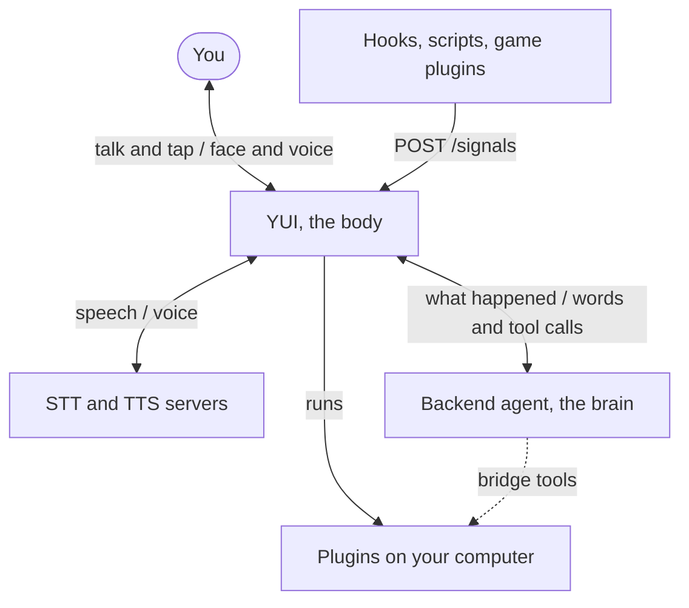
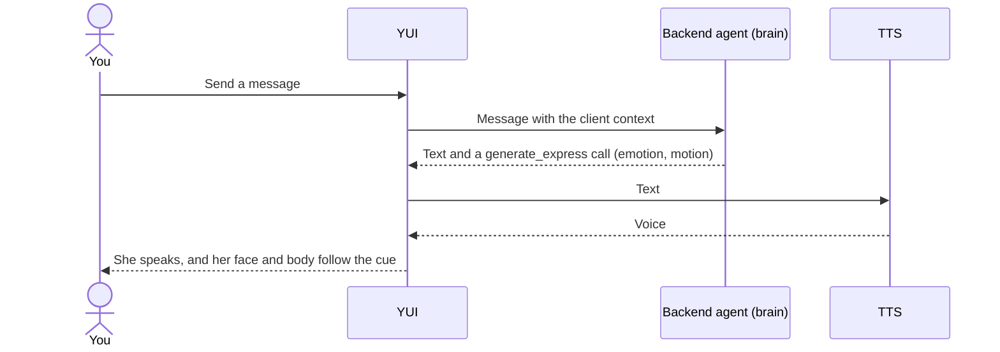

# How YUI works

YUI is the body. The model or agent you connect is the brain.

YUI sends the brain what happened, over Chat Completions, Responses or Push, and turns the answer into a face, a voice and gestures.

## One turn

## What decides what

- YUI notices events and picks who gets a turn.
- The brain decides whether to speak and what to say.
- YUI renders whatever arrives.

## Go deeper

- [Client Context](../reference/client-context.md): the per-turn block YUI sends.
- [Client Tools](../reference/client-tools.md): the tools the brain calls.
- [Push transport](../reference/push-transport.md): the contract for a backend that speaks first.
