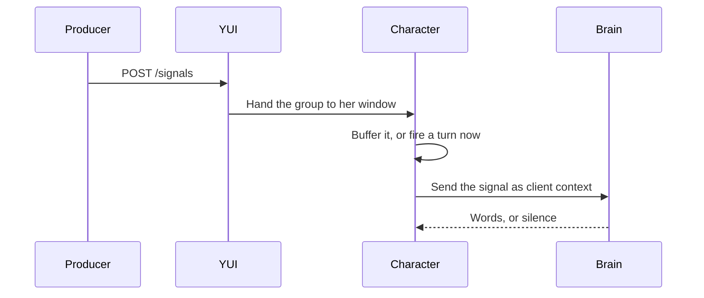

# Send signals from a producer

A producer is a program on your machine that posts a signal group to YUI's loopback ingress: an n8n workflow, a cron job, or a coding-agent hook.



The signal carries facts rather than a script; the brain decides what she says.

The work takes four steps:

1. [Pick a class](#pick-a-class)
2. [Write a label](#write-a-label)
3. [Choose an `event_id`](#choose-an-event-id)
4. [Send it](#send-it)

## Pick a class

`delivery` decides when she hears about a signal, and never what she says.

| Value | Use it when |
|---|---|
| `urgent` | The user should hear it now. |
| `batched` | It can wait for the next batch. |

Drop a signal by not sending it: `delivery` has no drop value.

## Write a label

`label` is one optional line on where the signal came from, in at most 120 code points: `devbox · tmux yui:2 · YUI (main)`.

## Choose an event_id

`event_id` names the thing the signal is about, so keeping it stable for the same thing lets a later buffered group replace the earlier one in place instead of adding a second. A `<session_id>:<phase>` pair works for a hook, and a run id for a workflow.

## Send it

Turn on **External signals** in Settings → Proactive → Watchers. The ingress listens on the port shown there, `8770` by default, and a change of either takes effect on the next launch. `POST /signals` wakes the main window's character; `POST /presets/<id>/signals` wakes the character bound to preset `<id>`.

**Manage presets** puts **Copy ingress URL for** _name_ on each preset row but the active one while **External signals** is on.

```bash
curl -s -o /dev/null -w '%{http_code}\n' -X POST \
  -H 'Content-Type: application/json' \
  -d '{"signals":[{"kind":"build","status":"failed"}],
       "envelope":{"source":"build-monitor","event_type":"build.failed",
                   "delivery":"urgent","event_id":"9f1c:build-failed",
                   "label":"devbox · tmux yui:2 · YUI (main)",
                   "occurred_at":1787449000000}}' \
  http://127.0.0.1:8770/signals
```

A `200` means the ingress accepted the wire shape and attempted to emit the batch. It confirms neither receipt nor delivery.

## Limits

| Limit | Value |
|---|---|
| The request body | 64 KiB; a larger body receives HTTP 400. |
| One signal item | 16 KiB serialized; a larger item receives HTTP 400 and no item of that request is delivered. |
| Each buffer | Five groups; the oldest drops on overflow. |

## Tips

- Reuse one `event_id` for a resend, so the pending group is replaced rather than added.
- Read the HTTP code: `503` means the preset's pet window is closed, so no window receives the group.

## Go deeper

[Signals ingress](../reference/signals-ingress.md) holds every route, envelope field and delivery rule.
