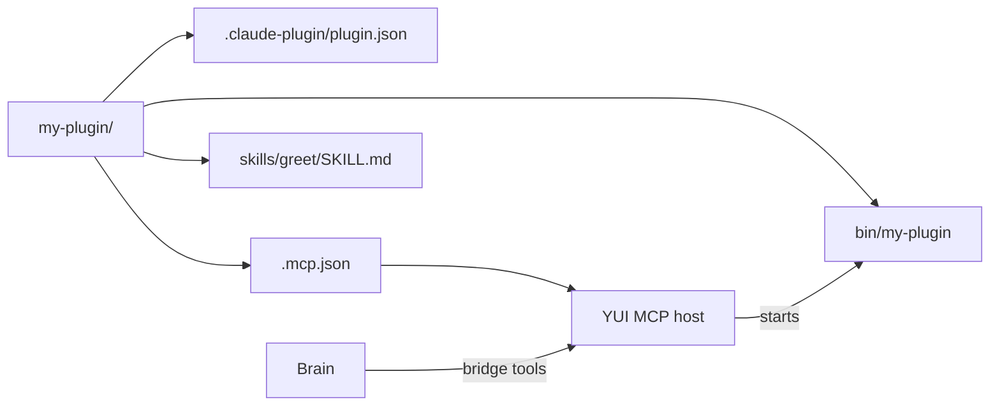

# Write a plugin

A plugin is one folder holding a manifest plus, optionally, MCP servers and skills. YUI runs each server, and the brain reaches its tools through the bridge tools.

To build one with a coding agent, paste this line:

```text
Build a YUI plugin that <what it should do>, following https://raw.githubusercontent.com/yw0nam/YUI/main/skills/yui-plugin/SKILL.md
```



The work takes four steps:

1. [Lay out the folder](#layout)
2. [Write the server](#servers)
3. [Declare tools and skills](#tools-and-skills)
4. [Test it locally](#test-locally)

## Layout

`bin/` holds a built server, though a server written in another language can sit wherever its `command` points.

YUI reads three fields of `plugin.json` and ignores the rest:

| Field | YUI uses it for |
|---|---|
| `name` | The plugin id: the catalog id, the log file name, and the name in every error. Lowercase letters, digits and `-`, starting with a letter or digit. |
| `version` | The version beside the plugin, and the one compared with the catalog to decide an update. |
| `description` | The line under the plugin's name on the Plugins page. |

```json
{
  "name": "my-plugin",
  "version": "0.1.0",
  "description": "One line on what the plugin lets a character do."
}
```

## Servers

`.mcp.json` names each server under `mcpServers`, with `command` required and `args` and `env` optional. YUI starts and lists the servers in the order their keys appear.

```json
{
  "mcpServers": {
    "my-plugin": {
      "command": "${CLAUDE_PLUGIN_ROOT}/bin/my-plugin",
      "args": ["--stdio"],
      "env": { "MY_PLUGIN_DATA": "${CLAUDE_PLUGIN_DATA}" }
    }
  }
}
```

YUI starts `command` with `args` as argv and no shell, so an argument reaches the server as written. It replaces `${CLAUDE_PLUGIN_ROOT}` and `${CLAUDE_PLUGIN_DATA}` in `command`, in every argument and in every `env` value.

ROOT is the plugin folder, which is also the working directory. DATA is the plugin's data folder: created before the start, deleted when the user removes the plugin. The server inherits YUI's environment, with `env` applied over it.

| What YUI expects | What happens |
|---|---|
| `initialize` and `tools/list` answer within 30 s together | A miss shows **Unavailable**, naming the step it stopped at. |
| A server that ends on its own | It shows **Exited** with **Restart**; the next app start runs it again. |
| A stop | YUI closes the connection, waits up to 1 s, then kills the server and every process it started. |
| The app killed without quitting | The next app start kills every process the server started (macOS). |
| stdout | The MCP channel, and nothing else. |
| stderr | Each line goes to the plugin log, prefixed `[<server>] ` and cut at 2000 bytes. |

## Tools and skills

A tool name held by a built-in client tool or by an already enabled plugin is hidden, though the later plugin still runs ([Plugins](./plugins.md)).

These names belong to built-in client tools: `address_character`, `body_action`, `generate_express`, `look`, `plugin_call`, `plugin_describe`, `plugin_skill`, `rate_relation`.

| `_meta` key | Where | What it does |
|---|---|---|
| `io.github.yw0nam.yui/summary` | the tool's `_meta` in `tools/list` | The one-line summary a turn shows for the tool ([Client Context § plugin tools](../reference/client-context.md#plugin-tools)). |
| `io.github.yw0nam.yui/wait_ms` | the tool's `_meta` in `tools/list` | How long the host waits for one call ([Client Tools](../reference/client-tools.md#waits-and-cancel)). |
| `io.github.yw0nam.yui/preset` | the request `_meta` of every `tools/call` | The preset id of the calling character, so a tool keeps one state per character. |

YUI checks `arguments` against the tool's `inputSchema` before it sends a call, and it sends no `arguments` field when that object is empty. It also sends `notifications/cancelled` when a wait has passed or a turn stops ([Client Tools](../reference/client-tools.md)).

A skill is `skills/<folder>/SKILL.md`, one level deep. Its frontmatter sits between `---` lines:

```markdown
---
name: greet
description: Greets the user in one line.
---
```

| Field | Rule |
|---|---|
| `description` | Required. A skill without one is skipped, with a warning in the app log. |
| `name` | Optional; the folder name when absent. `plugin_skill` and the per-turn line use it. |

`plugin_skill` returns the text after the frontmatter and nothing else, so the body carries every instruction and YUI serves no other file of the skill folder. The body is read on each call, while the name and description are read at turn-on, so a frontmatter edit needs the plugin off and on again.

## Test locally

Run the app (`pnpm tauri dev`, or a release build), open **Plugins**, choose **Add from folder…**, turn the plugin on and **Allow** once. The approval holds for that folder path while its files change; a new path asks again.

A change to `plugin.json`, `.mcp.json` or a skill's frontmatter needs the plugin off and on. **Retry** and **Restart** start a new process from the `.mcp.json` entry read at turn-on, so they pick up rebuilt server code but not a manifest change. While a server is running, neither button appears.

## Tips

- Start from [the test fixture](https://github.com/yw0nam/YUI/tree/main/src-tauri/fixtures/mcp-test-plugin): one server, one tool with `_meta`, and one skill.
- [plugins/browser](https://github.com/yw0nam/YUI/blob/main/plugins/browser/README.md) is a worked plugin with one tool.
- A server that the backend agent connects to itself is Backend-attached, so you configure it in that agent rather than in the plugin folder.

## Go deeper

- [Client Tools](../reference/client-tools.md): bridge tools, arguments, waits and consent.
- [Client Context § Plugin lines](../reference/client-context.md#plugin-lines): what a turn carries of a plugin's tools and skills.

To share it with other users, see [Contribute a plugin](./contribute-a-plugin.md).
