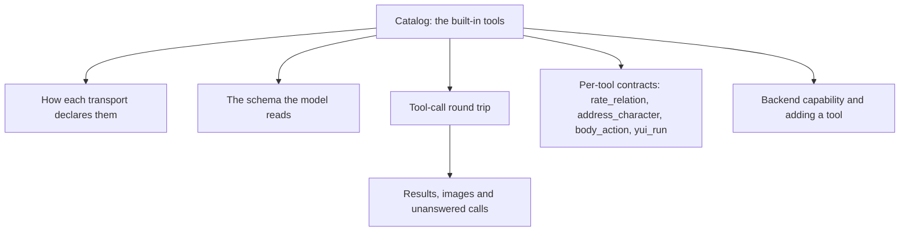
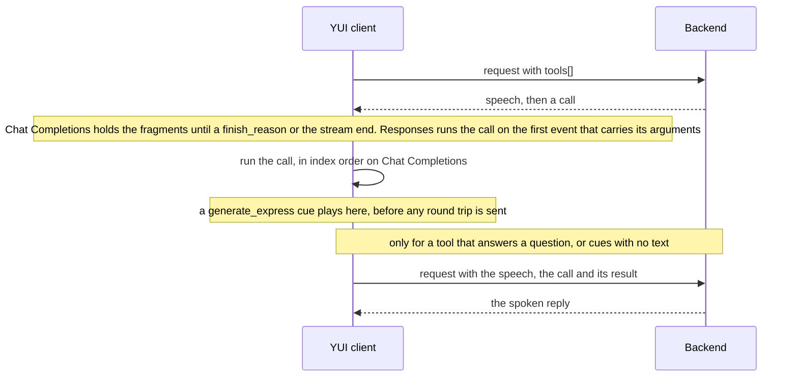
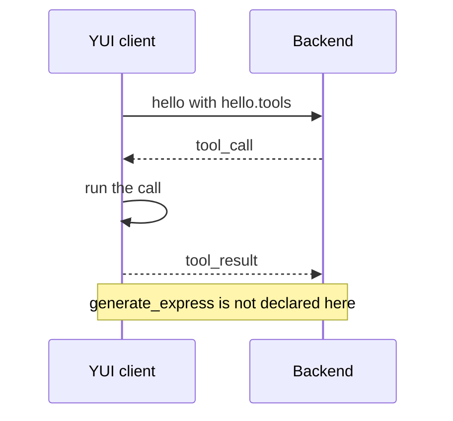

# Client tools

A client tool is a tool YUI runs itself when the backend calls it, and this page is the contract for its built-in tools: arguments, results, the transports that carry each call, and the code that declares and runs it. A backend author reads it to make a call; a client author reads it to add a tool.

Facts the backend needs to judge a turn arrive in `client_context` ([client-context.md](client-context.md)). Declared tools are the actions a reply performs: `generate_express`, `body_action`, `address_character` and `rate_relation`, plus `yui_run`. `yui_run` is the one way to reach every other read or change: YUI's settings, state, info, screen, Threads, terminals, plugins and guides, through the `yui` API.



Each row gives one tool's purpose, its arguments and result, the transports that carry it, and the code that builds and runs it.

| Name | Purpose | Arguments and result | Transports | Schema built in | Call executed in |
|---|---|---|---|---|---|
| `generate_express` | Places an expression cue (face, body motion, voice tone) on the speech around the call | Arguments `emotion_id`, `motion_id`, `emotion_text`, `caption`, each optional ([cue contract](client-context.md#tool-arguments)). Result: the string `ok` | Responses and Chat Completions as a declared tool. Push as cues inside `render` and `speech` segments | `createGenerateExpressTool` in `src/io/chat/tools/express.ts` | `runClientCall` in `src/io/chat/stream/client-tool-run.ts` |
| `body_action` | Moves the body: sit on a window's top edge, peek around its edge, move to a named spot, or stand up | Arguments `action` plus the field it needs: `app` for `sit_on_window`, `side` for `peek`, `spot` and an optional `monitor` for `move_to`; `stand` needs none. Result: `ok`, or one of the words `not_found`, `blocked`, `interrupted`, `busy`, `unsupported`, `timeout` after its 15 s wait, or `error: missing field <app\|side\|spot>` and `error: invalid field <app\|side\|spot>` for an absent or invalid argument | Responses, Chat Completions, and Push (`tool_call`/`tool_result`) | `createAvatarTools` in `src/io/chat/tools/avatar.ts` | `runClientCall` in `src/io/chat/stream/client-tool-run.ts`; on Push the consumer in `src/io/chat/push/tool-calls.ts` |
| `rate_relation` | Moves this character's relation toward the user or another open character by one small step, with the reason | Arguments `toward`, `delta` and `why`. Result: the band word after the change, `clamped: <band>` when the cap or the range held the value, or a refusal such as `error: unknown target` ([details](#rate-relation)) | Responses, Chat Completions, and Push (`tool_call`/`tool_result`) | `createRateRelationTool` in `src/io/chat/tools/relation.ts` | `runClientCall` in `src/io/chat/stream/client-tool-run.ts`; on Push the consumer in `src/io/chat/push/tool-calls.ts` |
| `address_character` | Names the character this reply is for, so that character receives a turn after the reply's playback | Arguments `to` (string: a name from the `open characters:` line) and optional boolean `handoff`, which passes the user's message to that character to answer. Result: `ok`, `ignored: already addressed <name>`, `error: unknown target` | Responses, Chat Completions, and Push (`tool_call`/`tool_result`) | `createAddressCharacterTool` in `src/io/chat/tools/address-character.ts` | `runClientCall` in `src/io/chat/stream/client-tool-run.ts`; on Push the consumer in `src/io/chat/push/tool-calls.ts` |
| `yui_run` | Runs a backend script against the `yui` API: YUI's settings, state and info, and the namespaces the window has ([The yui API](#the-yui-api)) | Argument `code` (string: an async function body). Result: a JSON object with `status`, `result` or `error`, `logs`, and the optional `note`, `writes` and `images` ([details](#yui_run)); `error: timed out after 121 s` when the wait passes | Responses, Chat Completions, and Push (`tool_call`/`tool_result`) | `createYuiRunTool` in `src/io/chat/tools/run/yui-run-tool.ts` | `runClientCall` in `src/io/chat/stream/client-tool-run.ts`; on Push the consumer in `src/io/chat/push/tool-calls.ts` |

## Declaration per transport

| Transport | Who declares the tool | How a call reaches the client |
|---|---|---|
| Chat Completions | The client declares the window subset in `tools[]` of every request | `delta.tool_calls` fragments |
| Responses | The client declares the window subset in `tools[]` of every request | `function_call` output items |
| Push | The client, in `hello.tools` of the connection and in a `tools` frame whenever the declared tools change | `tool_call` frames ([push-transport.md](push-transport.md)). `generate_express` is not declared there: its cues arrive in `render` and `speech` segments |

::: tip
`generate_express` is the one tool a push connection never declares. Its cues reach the client inside `render` and `speech` segments instead of a `tool_call` frame.
:::

### Which window declares which tools

`createClientTools` in `src/io/chat/tools/client-tools.ts` lists `generate_express` first, then the tools a window hands it. `src/io/chat/tools/pet-window-tools.ts` builds that list per window.

| Window | Tools it hands to `createClientTools` |
|---|---|
| Every pet window | `rate_relation` and `address_character`, and under Tauri `yui_run` |
| `main` | the tools of every pet window, plus `body_action` |
| A bound pet window | `rate_relation`, `address_character`, and under Tauri `yui_run` |
| The browser build | `rate_relation` and `address_character` |

`main` alone creates the avatar executor and the Threads client, so only that window runs `body_action` and has the `yui.look` and `yui.threads` namespaces. Under Tauri every pet window has `yui.guide`, `yui.terminal` and `yui.plugins`: the terminals are the Rust shell's, which holds every Terminal, and the plugins are the MCP host's.

`src/app/turn/wire-dispatcher.ts` builds the registry from that list for each turn, as the `clientTools` dependency of the backend caller. The registry reads the vocabulary loaded at that moment, so a vocabulary edit (an added emotion, an added motion, a different voice engine, a different motion selection) reaches the schema on the next turn.

### Switch states

Every switchable in-app tool is declared in every switch state: the declared set (`tools[]` on Chat Completions and Responses, `hello.tools` on push) is identical whether the switch is on or off, so provider prompt caches keep matching the request prefix.

The switch is read when a call executes, so a tool whose switch went off after the request went out still refuses the call. `rate_relation` answers `error: relations are off` while the Relations switch is off. `yui.look.screen()` has no switch: it answers `error: screen capture is off` while `privacy.screen_requests` is off.

Each turn's client context carries one `tool switches:` line stating the on/off state of every switchable tool the window declares ([client-context.md](client-context.md)).

::: warning
A switch never changes the declared set. The client reads it when the call runs, so a switch turned off after the request went out still refuses that call.
:::

## Declared schema

`generate_express` is declared as an OpenAI function schema generated from the loaded vocabulary. Expression therefore works against any OpenAI-compatible endpoint whose model supports tool calling.

| Parameter | Schema |
|---|---|
| `emotion_id` | `string`, `enum` = the loaded emotion registry's ids |
| `motion_id` | `string`, `enum` = the loaded motion registry's ids minus reactive, ambient and `broker_publish: false` motions, narrowed by the user's expression-motion selection |
| `emotion_text` | `string`. On an enum-mode TTS provider, `pattern` takes one or more of that provider's tags in a row (a repeat intensifies), with each tag's meaning in the description. On other providers, free text |
| `caption` | `string`, free-text voice direction for the speech around the call |

Every parameter is optional and `additionalProperties` is `false`.

### Shape on each transport

Chat Completions nests the schema: `{"type":"function","function":{"name","description","parameters"}}`. Responses flattens it: `{"type":"function","name","description","parameters","strict":false}`. A request with an empty registry carries no `tools` key.

### Cost per request

Each request of a turn carries the whole declared set again, round trips included. The main window declares five tool schemas: `generate_express`, `rate_relation`, `address_character`, `body_action` and `yui_run`.

The schema bytes change only when the vocabulary does: the emotion registry, the motion catalog or the user's motion selection, or the TTS provider. Between those changes every request repeats the same prefix, which a provider's prompt cache can match.

### Motion selection

When the motion selection is empty, the schema omits `motion_id` and the tool description omits body motion. A cue that names a deselected motion still renders: the selection limits what the model is offered.

## Tool-call round trip



On push the call arrives on the open connection instead:



`generate_express` has no frame here: its cues arrive inside `render` and `speech` segments.

### When a call is executed

On Chat Completions a call arrives as `chat.completion.chunk` tool-call deltas (`delta.tool_calls[].function.arguments`). The client accumulates the fragments per call index and holds them until a chunk carries a `finish_reason`, or until the stream ends.

It then executes the held calls in index order, and `generate_express` plays its cue at that point. A server that sends `finish_reason` once, on the last chunk of the response, delivers every cue of that response after that response's text.

On Responses a call arrives as a `function_call` output item (`call_id`, `name`, `arguments`). The complete arguments are first known on one of `response.output_item.added`, `response.function_call_arguments.done` or `response.output_item.done`.

The client executes the call once, on the first of those events that carries them, and the cue plays at that point in the stream.

On both transports the cue plays before any round trip is sent.

### When results go back

The results go back to the model in two cases:

1. A tool that answers a question ran, and its result is the reason the model called it.
2. Only cue-only tools ran and the response had no text, so the model is waiting for them. On Chat Completions `finish_reason` plays no part, because servers report different values on a response that called tools.

`generate_express` is cue-only. A response that spoke alongside its cues is a complete turn, and answering it makes the model say the reply again.

A model stays silent by answering that round trip with no text, and the turn ends with no speech (firing ≠ judgment).

The cycle repeats while the model keeps asking, up to eight round trips per turn (`MAX_TOOL_ROUND_TRIPS` in `src/io/chat/stream/stream-helpers.ts`). Past eight the client closes the turn with the text it has.

Speech from consecutive responses of a turn is joined with one space, unless the earlier text ends in whitespace or one of `。` `！` `？` or the later text starts with whitespace.

A tool whose execution throws returns `error: <message>` as its result. A call whose arguments are unparseable JSON is not run and returns `error: arguments JSON parse failed: <message>` as its result and plays no cue. The result goes back to the model under the same rule as any other result.

### What goes back on a call

On Chat Completions an executed call goes back on the assistant message with its top-level fields beyond `index`, `id`, `type` and `function`, so a server's per-call state reaches the next request.

### On the wire

Chat Completions appends two things to the message array of the turn in flight: the assistant message carrying the response's spoken text as `content` beside the `tool_calls` (`content: null` when the response said nothing), and one `role: "tool"` message per call (`tool_call_id` and the result string). It then sends the whole array again with the same `tools[]`.

On Chat Completions, every request of the turn carries the same `user` value.

```jsonc
// request 1: messages + tools[]
// response 1: speech deltas, then tool-call deltas
{"choices":[{"index":0,"delta":{"content":"Let me check."},"finish_reason":null}]}
{"choices":[{"index":0,"delta":{"tool_calls":[{"index":0,"id":"call_1","type":"function","function":{"name":"lookup","arguments":"{\"q\":\"answer\"}"}}]},"finish_reason":null}]}
{"choices":[{"index":0,"delta":{},"finish_reason":"tool_calls"}]}

// request 2: the same messages and tools[], with these two appended
{"role":"assistant","content":"Let me check.","tool_calls":[{"id":"call_1","type":"function","function":{"name":"lookup","arguments":"{\"q\":\"answer\"}"}}]}
{"role":"tool","tool_call_id":"call_1","content":"42"}

// response 2: the spoken text
{"choices":[{"index":0,"delta":{"content":"It is 42."},"finish_reason":null}]}
{"choices":[{"index":0,"delta":{},"finish_reason":"stop"}]}
```

Responses sends another request whose `input` holds, in order (a message item carries `type: "message"`):

1. the original input items
2. an assistant message item carrying the response's spoken text (omitted when the response said nothing)
3. the tool-calling response's `reasoning` items and each executed call as a `function_call` item, in the order the response produced them
4. one `function_call_output` item per call

The request keeps the turn's original `previous_response_id`, so the round trip works on a server that has dropped the tool-calling response. The `completed` event carries the id of the last response of the turn.

```jsonc
// request 1: input items + tools[]
// response 1: a speech delta, then a function_call item
{"type":"response.output_text.delta","delta":"Let me check."}
{"type":"function_call","call_id":"call_1","name":"lookup","arguments":"{\"q\":\"answer\"}"}

// request 2: the same tools[] and previous_response_id, input = the original items plus
{"type":"message","role":"assistant","content":"Let me check."}
{"type":"reasoning","id":"rs_1","summary":[]}
{"type":"function_call","call_id":"call_1","name":"lookup","arguments":"{\"q\":\"answer\"}"}
{"type":"function_call_output","call_id":"call_1","output":"42"}

// response 2: the spoken text
{"type":"response.output_text.delta","delta":"It is 42."}
```

### Image results

An image result carries its `text` in the Chat Completions tool message, with the note that the image follows in the next user message. One image-only user message with `image_url` parts follows all tool messages of that round.

Responses carries an array in `function_call_output.output`: an `input_text` part followed by `input_image` parts with `image_url` and `detail: "auto"`. String results keep string output.

Push carries the text in `tool_result.result` and the data URLs in `tool_result.images`.

Under `yui_run`, an image reaches the model only when the script's returned value holds its handle ([Image handles](#image-handles)).

### Calls left unanswered on Responses

A Responses turn ends on a response with unanswered calls in two cases: a cue-only call beside speech, and the round-trip cap.

The next turn chains on that response, and a server that checks tool pairing rejects a `function_call` that has no output. The `completed` event therefore carries a `function_call_output` item per unanswered call.

The client stores them with the response id and sends them ahead of the next turn's user message whenever it sends that id; they are dropped with the id, on a session reset and on the retry that follows a 404.

### Tools the backend runs

A tool outside the registry runs on the backend, and the client shows it as tool status and sends no result.

Responses shows `running` when the call item is added and `done` when it completes. Chat Completions shows `done` alone, when the held call is released.

Only a tool whose name is exactly `generate_express` plays an expression cue, and only a registered tool receives an answer.

### What the next turn carries

Tool traffic lives in the in-flight request, and the next Chat Completions turn is rebuilt from the stored transcript, which holds user and assistant speech text.

A Responses turn chains on the id of the previous turn's last response. A 404 for a stored id resets the chain with one retry that sends no id.

## rate_relation

The client keeps one directed integer per target and preset; a target is `user` or another preset. The value runs from -20 to 20, starts at 0, and falls in five bands: hostile ≤ -12, cold ≤ -4, neutral, warm ≥ 4, close ≥ 12. The store is `yui.relations`, or `yui.<id>.relations` on a preset other than the default (see [signals-ingress.md](signals-ingress.md#relations)).

The backend moves the value. The client holds it, caps it, renders it as the `relation:` line of every turn ([client-context.md](client-context.md#relation)) and shows the band in the preset row of the settings window. The client never changes the value on its own: no decay, no rule of its own.

### Arguments and result

| Argument | Shape |
|---|---|
| `toward` | A string: `user`, or a name from the `open characters:` line |
| `delta` | An enum: -2, -1, 1 or 2 |
| `why` | A string of at most 80 characters |

The result is the band word after the change: `hostile`, `cold`, `neutral`, `warm` or `close`.

A call cut by the daily cap or the range answers `clamped: <band>`. A second call for the same target in the same turn answers `ignored: already rated <toward> this turn`.

A refusal is one of these strings:

- `error: unknown target`
- `error: invalid field delta`, for a `delta` outside the enum
- `error: invalid field why`, for a non-string `why`
- `error: reserved reason`, for the `why` `set by the user`
- `error: relations are off`, while the Relations switch is off

### Targets and the cap

`toward` names `user` or one of the other presets open at that moment (main's active preset and the open pet windows), as the `open characters:` line of the turn lists them ([client-context.md](client-context.md#open-characters)).

The schema carries no enum, so the declared set is identical whatever is open and provider prompt caches keep matching. The name is checked when the call runs against the presets open at that moment.

A preset named `user` is listed as `user (character)`, so the bare `user` is always the human. The entry maps to the preset id; an entry outside the list answers `error: unknown target`.

`delta` is one of -2, -1, 1, 2, and `why` is the reason in at most 80 characters; it is stored with the change and shown to the user, so it is written for the user to read.

One accepted call per target per turn: a second call for the same target in the same turn answers `ignored: already rated <toward> this turn` and changes nothing.

At most 4 points of change per target per local calendar day, counted as the sum of the absolute deltas accepted that day. A call that would pass the cap, or push the value past -20 or 20, is cut to what fits and answers `clamped: <band>`; a call cut to nothing is not logged.

The result is the band after the change, so the model knows where it stands without a number.

### The Relations switch

The Relations switch (settings → Together → Relations, on by default, one switch for every preset) turns relations off as a whole. While it is off, `rate_relation` stays declared, carries the switch id `relations`, and answers `error: relations are off`; the turn carries no `relation:` line, and the stored values are kept.

In the same section the user sets a value by hand with a slider: the change is logged as one jump with the reason `set by the user`, spends none of the daily cap, and is held only by the range.

That reason is reserved for the user: a call whose `why` is `set by the user` answers `error: reserved reason` and changes nothing.

## address_character

The backend names, per reply, which other open character the reply speaks to. `to` names one of the other presets open at that moment (main's active preset and the open pet windows), as the `open characters:` line of the turn lists them ([client-context.md](client-context.md#open-characters)).

The schema carries no enum, so the declared set is identical whatever is open and provider prompt caches keep matching. The name is checked when the call runs against the presets open at that moment. The entry maps to the preset id; an entry outside the list answers `error: unknown target`. The user is never a target.

### Handoff

Optional boolean `handoff` passes the user's message on this turn to the named character, who takes it and answers the user. The tool's description tells the model to set it only when the user asks to pass their message to that character, and to say only briefly in its own reply that it passed it on.

The receiving trigger carries `user_message` verbatim from the admitted user turn. A turn without a user message produces a plain address even when `handoff` is true.

### After the reply

One call per reply: a second call in the same turn changes nothing and answers `ignored: already addressed <name>`, where the name is the character addressed first.

The call records the recipient on the turn, and when the turn ends `ok` having spoken and the reply's playback has finished, the client emits the `yui://character-addressed` bridge event. The named character's window turns that event into an `addressed` turn ([client-context.md](client-context.md#addressed)) held by the chain cap `rate_limit.addressed_chain_max`.

The client routes; the named character's backend decides whether to answer, and a `[SILENT]` reply ends the exchange.

### No switch

The tool has no switch, so `tool switches:` does not list it, and it stays declared whatever the Relations switch holds.

## yui_run

`yui_run` runs a script the backend writes against the `yui` API: the namespaces its window has, listed under [The yui API](#the-yui-api). `code` is the body of an async function, so the script uses `await` and returns a JSON value.

The description's first sentence names what the window can do, from its namespaces. In `main` it reads `YUI: see the screen and body, Threads, terminals, plugins, guides, settings.` It stays within 80 characters, because a backend may show only a tool's first sentence; Hermes's tool search cuts it there.

The rest of the description tells the backend to call `help()` first, which returns the API as text.

### Model requirements

`yui_run` works only as well as the model writes scripts. The client does not repair a script that loses its own result. In 40 test turns (120 calls) through Hermes Agent, Claude Sonnet 5.5 always called `help()` first, returned at the top level and returned image handles whole. The test used stub namespaces, so it shows that a returned handle reaches the model, not how well the model reads a real screen.

Models weaker at tool calling and code lose their results more often. On the same user messages, GPT-OSS-120B sometimes wrapped its code in an async function with no top-level `return`, repeated that shape after it failed, or skipped the tool. Gemma-4-26B-A4B returned a screenshot's `text` instead of its handle and called methods the API does not declare.

### Sandbox

The script reaches these host globals: `yui`, `help()` and `console.log`. The QuickJS built-ins such as `JSON`, `Math` and `Promise` remain ([`sandbox.ts`](../../src/io/chat/tools/run/sandbox.ts)). Each call runs in a fresh module with 1000 ms of CPU, a 256 KiB stack and a 64 MiB heap.

The JSON of its logs and its result together may total 64 Ki (65 536) characters; a larger result answers `error`. The defaults are `DEFAULT_LIMITS` in `src/io/chat/tools/run/sandbox.ts`.

### The yui API

Each window has these namespaces. `help()` prints the blocks of the namespaces the window has, in the order settings, state, info, guide, terminal, plugins, look, threads (`src/io/chat/tools/run/help.ts`; `src/io/chat/tools/run/yui-run-tool.ts`).

| Namespace | Window |
|---|---|
| `settings`, `state`, `info` | every pet window under Tauri |
| `guide`, `terminal`, `plugins` | every pet window under Tauri |
| `look`, `threads` | `main` only |

The browser build has no `yui_run`, so it has none of these.

- `yui.settings.read()` returns the exposed settings document: this character's settings and the global ones.
- `yui.settings.write(patch, { why })` applies a JSON merge patch (RFC 7396) to that document and answers one result per path in the patch. `why` is a string the user reads on the card.
- `yui.state.read()` returns `running_since`, `last_together`, the `characters` with their `open` and `me` flags, and `permissions.screen_recording`.
- `yui.info.read()` returns the `bodies`, `voices` and `monitors` a setting can name, each with its id or index.

A yui call that fails returns its error text as a value. Only a wrong argument throws: each namespace checks its own arguments and throws a `TypeError` whose message starts `yui.<namespace>.<method>:`. The guest reads that as `Error: yui.<namespace>.<method>: …`, because the sandbox hands a host rejection over as a plain `Error`.

### Result

A script that returns gives `{ "status": "completed", "result": <value>, "logs": [...] }`. A script that ends without a return gets `"note": "the script returned nothing; end it with return and a JSON value"` beside `result: null`. A script that throws, runs past a limit or never settles gives `{ "status": "error", "error": "<text>", "logs": [...] }`.

An uncaught throw reads `Error: <message>`.

`"writes"` lists the answers of every `yui.settings.write` that finished before the run ended, in the order they finished, on completed and error results alike. The key is absent when the run wrote nothing.

A `code` that is not a string answers the same error form with `code must be a string`.

A call marks as failed when its result has `status` `error` or starts with `error:`, such as `error: timed out after 121 s`, the answer when the wait passes.

The wait covers the whole script, including any Settings request inside it. The backend's wait is 125 s ([push-transport.md](push-transport.md#tool-call-waits)).

A patch that is not an object answers `{ "*": "error: patch must be an object" }`. A `why` that is not a string answers `{ "*": "error: why must be a string" }`. Both are refused before any Settings request is raised.

### Image handles

A yui call that yields an image returns `{ "image": n }` in its place. `yui.look.screen()` and `yui.plugins.call()` do. Handles count from 1 within the run.

The result carries only the images whose handles appear in the returned value, in ascending handle order. The envelope names them in `"images"`, and the tool result carries those images beside its text (`src/io/chat/tools/run/yui-run-tool.ts`; `images.ts`).

The 64 Ki output cap covers the result and the logs, with each handle counted. Image data is not counted.

### Status

While a script runs, the status pill names the namespace of the last yui call that reports: `look`, `threads` or `terminal`. Calls to `settings`, `state`, `info` and `guide` do not report. For `yui.plugins.call(name, …)` the pill names `name`.

Before the first such call it shows `yui_run`, and it keeps the last name until the call ends. The labels are `tool.look` "Looking…", `tool.threads` "Reading Threads…", `tool.terminal` "Using a terminal…" and `tool.yui_run` "Running a script…".

Each report reaches the pill while the call runs, on Responses, Chat Completions and Push (`src/io/chat/stream/client-tool-run.ts`; `src/io/chat/push/tool-calls.ts`). Reports stop when the call settles or aborts.

On Push, `yui_run` is `localStatus`, so a backend `tool_status` naming `yui_run` does not change the pill (`src/io/chat/tools/run/yui-run-tool.ts`; `src/app/turn/push/wire-push.ts`).

### Direct and allow rows

Each settings row is `direct` or `allow`. A `direct` row applies its write at once. An `allow` row waits for the user: its path answers only after the user's decision on a Settings request. The `yui.settings.write` result has one entry per path:

| Result | Meaning |
|---|---|
| `ok` | The value is set, applied at once or after Allow |
| `ok: <note>` | The user allowed the path, the value is set, and the user wrote this note |
| `denied` | The user did not allow the path |
| `denied: <note>` | The user did not allow the path and wrote this note |
| `no answer` | The card's 60 s passed, or the turn ended before an answer |
| `error: a settings request is already waiting` | The window already holds one Settings request; put every allow change in one write |
| `error: invalid <path>` | The row refuses the value, or an allowed write finds the value refused when it runs |
| `error: unknown <path>` | The patch names a path no row holds |
| `error: <path> failed to load` | A write rejected before it stored the value |

A note rides every allow path of its request that answers `ok` or `denied`. An allowed path whose write fails keeps its `error: …` result with no note. Direct paths never carry a note.

`help()` lists each row's access, and the settings table itself is in `src/settings/agent-access/rows.ts`.

### Settings request

An allow write raises one Settings request for all of its allow paths. The window's Ask slot shows it on its own card, whose title names the character.

A window holds one Settings request at a time. A write whose allow paths would ask while one waits raises no card and answers `error: a settings request is already waiting` for every allow path; its direct paths are still written.

Each allow path has a line with its label and the value it changes from and to. Then come the `why` text, up to 200 characters, and a line saying the change applies to every character. Under them sit the "Add a note" link, Deny and Allow.

The window's ask queue holds the card behind the Asks already open, and the oldest shows first. The card waits 60 s once shown. A card that times out, or whose turn stops, answers `no answer` for every allow path, and a note typed but not sent is dropped ([`settings-request.ts`](../../src/app/turn/settings-request.ts), [`settings-request-card.ts`](../../src/ui/settings-request/settings-request-card.ts)).

#### Decision

The user answers with a decision: the paths they allow, and an optional note.

- With one allow path, Deny and Allow each answer on one click.
- With several, each path has its own checkbox, unchecked at first. Allow is disabled while nothing is checked and reads "Allow N" once N are checked. It writes the checked paths and answers `denied` for the rest.
- Deny answers `denied` for every allow path.

"Add a note" opens a field of up to 200 characters, which the card trims. Enter in the field sends Allow N when a path is checked, and Deny otherwise; Shift+Enter starts a new line. The note rides whichever button sends.

After Allow, each allowed path answers `ok`, `ok: <note>` when the user wrote a note, `error: invalid <path>` or `error: <path> failed to load`. The direct paths of the same patch are written before the card and answer `ok`.

### yui.guide

`yui.guide.read(name)` returns one guide as the user reads it: `"controls"` (every gesture, key and button) or `"capabilities"` (what the character can do). The text leaves out the doc's Markdown image lines, which are pictures for the docs site (`readGuide` in `src/io/guide/guide-docs.ts`). Any other name throws, and the script reads `Error: yui.guide.read: name must be "controls" or "capabilities"` (`createGuideApi` in `src/io/guide/guide-docs.ts`).

### yui.look

`yui.look` is in `main` only. It reads her body, her perch targets and a screenshot. Her moves stay with the `body_action` tool.

- `body()` returns her body state: her position, posture, loaded body and whether a move runs. Without an executor it answers `error: unsupported`; a failed read answers `error: <message>`.
- `perch_targets()` returns the windows she can sit on and the sides of the frontmost window she can peek from.
- `screen(monitor?)` returns `{ text, images }`: `text` is `screenshot of display <n>`, and `images` holds one handle ([Image handles](#image-handles)). An omitted `monitor` selects the display her window's centre is on.
- `screen` answers `error: screen capture is off` while `privacy.screen_requests` is off (`screen-query.ts`; `src/settings/agent-access/rows.ts`), and `error: invalid field monitor` for an index past the displays. A `monitor` that is not an integer throws.

### yui.threads

`yui.threads` is in `main` only, the window that creates the Thread client.

- `list(opts?)` lists the user's Threads newest first as text rows: the waiting ones by default, every Thread with `state: "all"`, and one source with `source`. It holds 20 rows, then `(N more)`. Each row shows its last entry cut at 160 characters.
- With `id`, it reads one Thread: its newest 20 entries, oldest first, each cut at 2000 characters (`threads-api.ts`; `thread-text.ts`). An unknown id answers `error: unknown thread: <id>`.
- `search(query)` lists the Threads whose title, label or entry text holds `query`, case-insensitively, newest first, at most 10, each with a `match:` line (`threads-api.ts`; `thread-text.ts`).

A `state` other than `"waiting"` or `"all"`, a `source` or `id` that is not a non-empty string, an `opts` that is not an object, and a `search` query that is not a non-empty string all throw.

A turn's [`threads attached:`](client-context.md#threads-attached) block names the ids of the Threads the user attached to the message.

### yui.plugins

`yui.plugins` reaches the enabled plugins' tools, in every pet window under Tauri.

- `list()` returns `{ name, summary }` for each enabled tool.
- `describe(name)` returns the tool's description and JSON input schema, or `error: unknown tool: <name>`.
- `call(name, args?)` runs the tool and returns `{ text, images }`. A `null` `args` counts as absent, and `args` that is not an object throws.

`call` checks `args` against the tool's input schema before it sends the call. A violation throws `yui.plugins.call: invalid arguments (<location>: <message>)`, followed by the schema (`plugins-api.ts`; `src/io/chat/tools/plugins/first-violation.ts`). A schema the check cannot read is not checked, and the call goes to the server.

### The lists in the descriptions

The `yui_run` description lists the enabled plugin tools and plugin skills, and it changes with the MCP host snapshot (`src/io/chat/tools/run/yui-run-tool.ts`; `src/io/chat/tools/plugins/plugins-api.ts`).

- The tools follow `Plugin tools, run with yui.plugins.call:`, and the skills follow `Plugin skills, read with help("plugin:<name>"):`. Each entry reads `<name> — <text>`, or the name alone when the text is empty, and entries are joined with ` · `.
- A tool's summary is its non-empty `io.github.yw0nam.yui/summary` meta. Without one, it is the first sentence of its description's first paragraph. Every summary is cut at 100 characters.
- A skill's description is cut at 1024 characters.

The description is read once per turn, when the turn builds its declared tools, so a plugin turned on or off shows on the next turn. Push sends it in `hello.tools` and again in a `tools` frame on every snapshot change.

### Which names resolve

A plugin tool name resolves against the newest snapshot when the call runs (`plugins-api.ts`; `src/io/mcp-host/enabled-plugins.ts`).

Only the five declared names are reserved. `src/contract/builtin-client-tools.json` lists `address_character`, `body_action`, `generate_express`, `rate_relation` and `yui_run`, and the MCP host hides a plugin tool that takes one of them. Plugins resolve in enable order (`enabled_seq`), so the plugin enabled earlier keeps a name two plugins share.

The hidden entry leaves the tools and skills lists, and `yui.plugins.describe` and `call` see it as absent.

### Result of a plugin call

`yui.plugins.call` answers the MCP `tools/call` result as `{ text, images }`. Text blocks are joined with one newline. An image block becomes a `data:<mimeType>;base64,<data>` URL, which the run turns into a handle, and any other block is its JSON (`src/io/chat/tools/plugins/plugin-result.ts`; `src/io/chat/tools/run/bind-namespace.ts`).

`isError: true` prefixes the joined text with `error: ` unless it already starts with `error:` or `unknown:`, so a plugin's own error text keeps one prefix.

A failure of the call itself answers `{ text: "error: <text>", images: [] }`: `error: unknown tool: <name>` when no enabled plugin holds the name, `error: plugin tool timed out after <n> ms`, `error: plugin tool cancelled`, or a server's own error string.

### Waits and cancel

| Call | Client wait | Host deadline |
|---|---|---|
| `yui.plugins.call` | none of its own: the run's 121 s bounds it | the tool's `_meta["io.github.yw0nam.yui/wait_ms"]`, 30 s by default and 120 s at most |
| `yui.plugins.list`, `describe` | none: they read the snapshot | none |

A stopped turn or an ended run cancels the host call. `yui.plugins.call` sends the call's id to `plugin_host_cancel` when its signal aborts, and the host sends `notifications/cancelled` to the server with the reason. A cancel that arrives before the call registers stops it when it registers.

A turn stopped before the call started answers `{ text: "error: turn stopped", images: [] }` and sends nothing.

### Status and consent

For Plugin tools, no call asks the user again: enabling the plugin in settings records consent for its folder, and the host starts its servers and publishes its tools only while that consent holds. A plugin whose folder moved after the user enabled it starts no server, so its names answer `error: unknown tool: <name>`.

Each Plugin tool call carries the preset id of the calling window: the host sends it in the `tools/call` request's `_meta["io.github.yw0nam.yui/preset"]`, so a plugin tool knows which character called it.

### `help("plugin:<name>")`

`help` is async, so `return help()` answers the API text, and `help()` returns a Promise to `await`. The text ends with the nine usage rules.

`help("plugin:<name>")` returns the plugin skill's text, which the host reads through `plugin_host_skill` (`src/io/chat/tools/run/help-topic.ts`; `src/io/mcp-host/mcp-host.ts`). Any other topic throws `help: topic must be plugin:<name>`.

### yui.terminal {#terminal-tools}

The Rust shell runs each Terminal in a PTY, and every pet window under Tauri reaches them through `yui.terminal`. Opening a Terminal and closing one the calling preset opened run without asking the user.

- `open({ cwd? })` answers `opened <id> (<title>)`, or an error such as `error: too many terminals (16 open); close one first`.
- `list()` answers one line per terminal: `<id> | <owner> | <title> | running or exited <code> | access: <preset id or none>`, or `no terminals`.
- `read(id, { lines? })` answers the untrusted-content line, then `<id> (<title>), <status>`, then the rendered screen: the last `lines` rows, 100 by default and 500 at most, with trailing blank rows dropped. The text is cut to 32 KiB, and `[cut]` comes first when it is cut.
- `write(id, text, { enter? })` writes `text` as given, so `"\u0003"` sends Ctrl-C, and appends `\r` unless `enter` is false.
- `close(id)` closes a Terminal the calling preset opened, and answers `error: not your terminal: <id>` for another preset's.

#### Allow and cancel

A read or write on a Terminal the calling preset has no access to asks the user for Allow. The Allow card counts down its 60 s, and Deny answers `denied`. No answer in 60 s answers `denied: no answer in 60 s`.

Allow gives that preset access until the user presses Take back, or until another preset's request is allowed, which moves the access to that preset. Take back clears the access. A write records its first line, trimmed, as the Terminal's last command, which the access line shows.

Reads and writes have no client wait of their own, and the run's 121 s bounds them. A stopped turn, or a run that ends, cancels a waiting read or write through `terminal_tool_cancel`, and the call answers `error: turn stopped`.

## Backend capability

A screenshot from `yui.look.screen()` needs an image-capable model and provider on the backend.

Cue delivery over a request transport needs an endpoint that serves the declared tool back as a call. A plain OpenAI-compatible server (e.g. vLLM) does this, on Chat Completions as `delta.tool_calls` fragments and on Responses as `function_call` output items.

On Chat Completions and Responses every declared schema rides every request, and the model reads it on every turn.

### Hermes api-server

The Hermes api-server does not pass a request's `tools` to its model on either transport, so its backend receives `body_action`, `rate_relation`, `address_character` and `yui_run` on the push transport only. `generate_express` is not declared on push: its cues ride the `render` and `speech` segments.

Its `/v1/chat/completions` surfaces no tool calls and emits a `hermes.tool.progress` telemetry event with name and status.

## Adding a tool

① Export a `create<Name>Tool` factory from `src/io/chat/tools/` that returns a `ClientTool`. `client-tools.ts` holds the registry and the `ClientTool` type, one file per tool otherwise. Set `oneWay: true` only on a tool whose result tells the model nothing, and `failed` on a tool whose failure results do not start with `error:`.

② Add the tool to the list `createClientTools` returns in `src/io/chat/tools/client-tools.ts`. `src/app/turn/wire-dispatcher.ts` declares that list on every turn. A tool that needs a handle only one window owns joins the array that window hands to `createClientTools`, as the avatar tools do; the push socket declares that array in `hello.tools`.

③ Add its row to the catalog table at the top of this page. `src/io/chat/tools/client-tools.test.ts` fails while a tool in that list has no row.

④ A read or action on YUI's settings, state, info or a namespace joins the `yui` API: a namespace module with a `create<Name>Api` factory, given to the window in `src/io/chat/tools/pet-window-tools.ts`, and listed in the help order in `src/io/chat/tools/run/yui-run-tool.ts`. It gets no tool of its own. An action that performs a reply is a declared tool, added as in ①–③.
