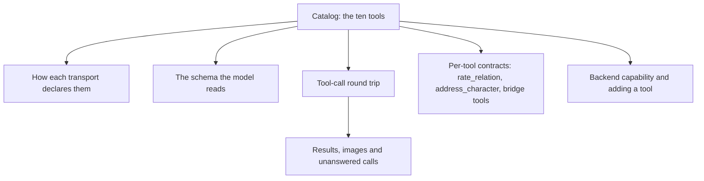
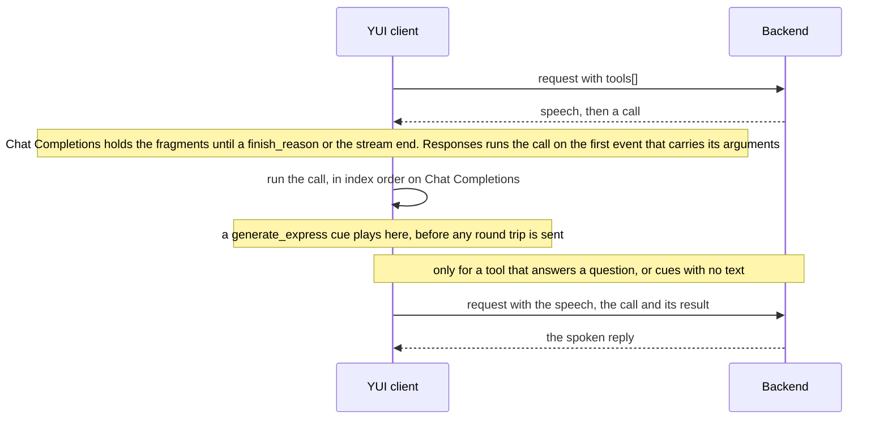
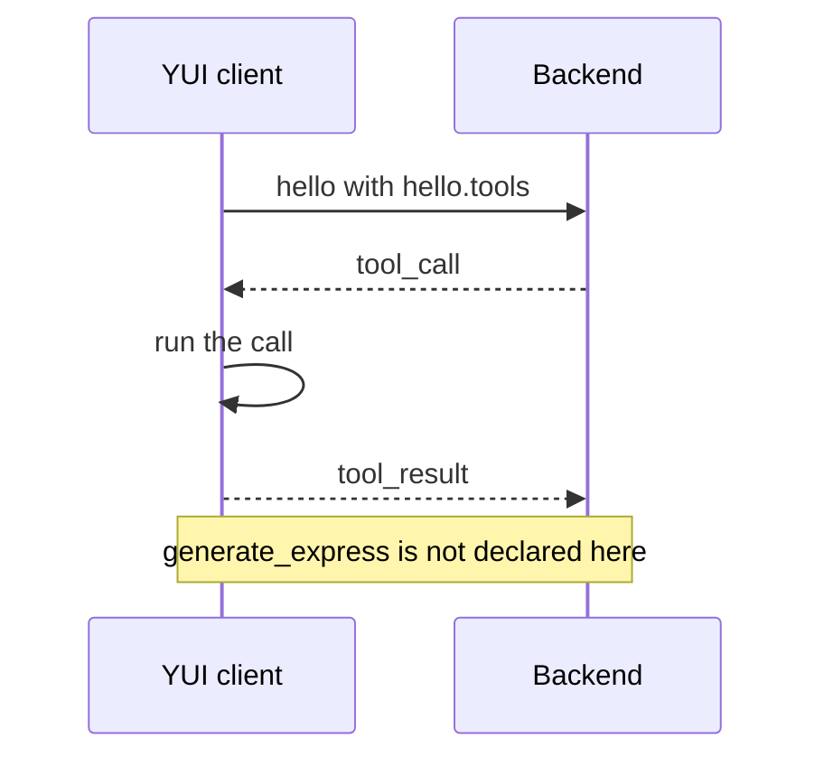

# Client tools

A client tool is a tool YUI runs itself when the backend calls it, and this page is the contract
for the ten of them: arguments, results, the transports that carry each call, and the code that
declares and runs it. A backend author reads it to make a call; a client author reads it to add a
tool.



Each row gives one tool's purpose, its arguments and result, the transports that carry it, and the
code that builds and runs it.

| Name | Purpose | Arguments and result | Transports | Schema built in | Call executed in |
|---|---|---|---|---|---|
| `generate_express` | Places an expression cue (face, body motion, voice tone) on the speech around the call | Arguments `emotion_id`, `motion_id`, `emotion_text`, `caption`, each optional ([cue contract](client-context.md#tool-arguments)). Result: the string `ok` | Responses and Chat Completions as a declared tool. Push as cues inside `render` and `speech` segments | `createGenerateExpressTool` in `src/io/chat/tools/express.ts` | `runClientCall` in `src/io/chat/stream/client-tool-run.ts` |
| `body_action` | Moves the body: sit on a window's top edge, peek around its edge, move to a named spot, stand up, or lie down on a bed | Arguments `action` plus the field it needs: `app` for `sit_on_window`, `side` for `peek`, `spot` and an optional `monitor` for `move_to`; `stand` and `go_to_bed` need none. Result: `ok`, or one of the words `not_found`, `blocked`, `interrupted`, `busy`, `unsupported`, `timeout`, or `error: missing field <app\|side\|spot>` and `error: invalid field <app\|side\|spot>` for an absent or invalid argument | Responses, Chat Completions, and Push (`tool_call`/`tool_result`) | `createAvatarTools` in `src/io/chat/tools/avatar.ts` | `runClientCall` in `src/io/chat/stream/client-tool-run.ts`; on Push the consumer in `src/io/chat/push/tool-calls.ts` |
| `look` | Reads the character's body state, perch targets, or a display screenshot | Argument `at`: `body`, `perch_targets` or `screen`. Result: JSON for the body and perch targets, an image for `screen` ([details](#look)) | Responses, Chat Completions, and Push (`tool_call`/`tool_result`) | `createAvatarTools` in `src/io/chat/tools/avatar.ts` | `runClientCall` in `src/io/chat/stream/client-tool-run.ts`; on Push the consumer in `src/io/chat/push/tool-calls.ts` |
| `rate_relation` | Moves this character's relation toward the user or another open character by one small step, with the reason | Arguments `toward`, `delta` and `why`. Result: the new band word, `clamped: <band>` when the cap or the range held the value, or a refusal such as `error: unknown target` ([details](#rate-relation)) | Responses, Chat Completions, and Push (`tool_call`/`tool_result`) | `createRateRelationTool` in `src/io/chat/tools/relation.ts` | `runClientCall` in `src/io/chat/stream/client-tool-run.ts`; on Push the consumer in `src/io/chat/push/tool-calls.ts` |
| `address_character` | Names the character this reply is for, so that character receives a turn after the reply's playback | Arguments `to` (string: a name from the `open characters:` line) and optional boolean `handoff`, which passes the user's message to that character to answer. Result: `ok`, `ignored: already addressed <name>`, `error: unknown target` | Responses, Chat Completions, and Push (`tool_call`/`tool_result`) | `createAddressCharacterTool` in `src/io/chat/tools/address-character.ts` | `runClientCall` in `src/io/chat/stream/client-tool-run.ts`; on Push the consumer in `src/io/chat/push/tool-calls.ts` |
| `plugin_describe` | Describes a plugin tool the host publishes | Argument `name` (string: the plugin tool's name). Result: the tool's name, its description and its input schema on three lines, or `error: unknown plugin tool: <name>` | Responses, Chat Completions, and Push (`tool_call`/`tool_result`) | `createPluginBridgeTools` in `src/io/chat/tools/plugin-bridge/` | Tauri commands `plugin_host_call`/`plugin_host_cancel` (`plugin_call`) and `plugin_host_skill` (`plugin_skill`) in `src-tauri/src/mcp_host/`, invoked through `src/io/mcp-host/mcp-host.ts`; `plugin_describe` reads the host's snapshot |
| `plugin_call` | Runs a plugin tool the host publishes | Arguments `name` (string: the plugin tool's name) and `arguments` (object: the tool's arguments). Result: the tool's text and its images as data URLs, or `error: unknown plugin tool: <name>`, or `error: invalid arguments (<violation>)` with the tool's input schema | Responses, Chat Completions, and Push (`tool_call`/`tool_result`) | `createPluginBridgeTools` in `src/io/chat/tools/plugin-bridge/` | Tauri commands `plugin_host_call`/`plugin_host_cancel` (`plugin_call`) and `plugin_host_skill` (`plugin_skill`) in `src-tauri/src/mcp_host/`, invoked through `src/io/mcp-host/mcp-host.ts`; `plugin_describe` reads the host's snapshot |
| `plugin_skill` | Reads a plugin skill the host publishes | Argument `name` (string: the plugin skill's name). Result: the skill's instructions | Responses, Chat Completions, and Push (`tool_call`/`tool_result`) | `createPluginBridgeTools` in `src/io/chat/tools/plugin-bridge/` | Tauri commands `plugin_host_call`/`plugin_host_cancel` (`plugin_call`) and `plugin_host_skill` (`plugin_skill`) in `src-tauri/src/mcp_host/`, invoked through `src/io/mcp-host/mcp-host.ts`; `plugin_describe` reads the host's snapshot |
| `threads_list` | Lists the user's Threads: the ones waiting for the user's answer by default, every Thread with `state: "all"`, or one Thread's conversation by id | Arguments `state` (`"waiting"`, the default, or `"all"`), `source` (string, exact match) and `id` (string), all optional. Without `id`: at most 20 rows newest first, each with its open ask and last entry, then `(N more)` when cut. With `id`: that Thread's newest 20 entries oldest first, plus the open ask. Result: the rows, `no threads`, or `error: unknown thread: <id>` | Responses, Chat Completions, and Push (`tool_call`/`tool_result`) | `createThreadsTools` in `src/io/chat/tools/threads/` | The tool itself; no Tauri command — it reads the calling window's snapshot of the Thread store, so only the main window declares it |
| `threads_search` | Searches the user's Threads by text | Argument `query` (string, required). A case-insensitive substring over title, label and entry text. Result: the matching Threads newest first, at most 10, each with one `match:` line naming where the query hit, `no threads match "<query>"`, or `error: query must be a non-empty string` | Responses, Chat Completions, and Push (`tool_call`/`tool_result`) | `createThreadsTools` in `src/io/chat/tools/threads/` | The tool itself; no Tauri command — it reads the calling window's snapshot of the Thread store, so only the main window declares it |

## Declaration per transport

| Transport | Who declares the tool | How a call reaches the client |
|---|---|---|
| Chat Completions | The client, in `tools[]` of every request | `delta.tool_calls` fragments |
| Responses | The client, in `tools[]` of every request | `function_call` output items |
| Push | The client, in `hello.tools` of the connection | `tool_call` frames ([push-transport.md](push-transport.md)). `generate_express` is not declared there: its cues arrive in `render` and `speech` segments |

::: tip
`generate_express` is the one tool a push connection never declares. Its cues reach the client
inside `render` and `speech` segments instead of a `tool_call` frame.
:::

### Which window declares which tools

`createClientTools` in `src/io/chat/tools/client-tools.ts` lists `generate_express` first, then the
tools a window hands it. `src/io/chat/tools/pet-window-tools.ts` builds that list per window.

| Window | Tools it hands to `createClientTools` |
|---|---|
| Every pet window | `rate_relation` and `address_character`, and under Tauri the bridge tools `plugin_describe`, `plugin_call` and `plugin_skill` |
| `main` | the tools of every pet window, plus `body_action`, `look`, `threads_list` and `threads_search` |
| A bound pet window | `rate_relation`, `address_character`, and under Tauri the bridge tools |
| The browser build | `rate_relation` and `address_character` |

`main` alone creates the avatar executor and the Threads client, so only that window runs
`body_action` and `look` and declares `threads_list` and `threads_search`.

`src/app/turn/wire-dispatcher.ts` builds the registry from that list for each turn, as the
`clientTools` dependency of the backend caller. The registry reads the vocabulary loaded at that
moment, so a vocabulary edit (a new emotion, a new motion, a different voice engine, a changed
motion selection) reaches the schema on the next turn.

### When look is declared

The `look` declaration is independent of both screenshot settings. `main` alone declares `look`; the
browser build and a bound pet window declare none, so a push call there answers
`error: unknown tool`. A declared `look` whose executor is not yet available answers
`error: unsupported`.

### Switch states

Every switchable in-app tool is declared in every switch state: the declared set (`tools[]` on Chat
Completions and Responses, `hello.tools` on push) is identical whether the switch is on or off, so
provider prompt caches keep matching the request prefix.

The switch is read when a call executes, so a tool whose switch went off after the request went out
still refuses the call. `look at: screen` answers `error: screen capture is off`, and
`rate_relation` answers `error: relations are off`.

Each turn's client context carries one `tool switches:` line stating the on/off state of every
switchable tool the window declares ([client-context.md](client-context.md)).

::: warning
A switch never changes the declared set. The client reads it when the call runs, so a switch turned
off after the request went out still refuses that call.
:::

## Declared schema

`generate_express` is declared as an OpenAI function schema generated from the loaded vocabulary.
Expression therefore works against any OpenAI-compatible endpoint whose model supports tool calling.

| Parameter | Schema |
|---|---|
| `emotion_id` | `string`, `enum` = the loaded emotion registry's ids |
| `motion_id` | `string`, `enum` = the loaded motion registry's ids minus reactive, ambient and `broker_publish: false` motions, narrowed by the user's expression-motion selection |
| `emotion_text` | `string`. On an enum-mode TTS provider, `pattern` takes one or more of that provider's tags in a row (a repeat intensifies), with each tag's meaning in the description. On other providers, free text |
| `caption` | `string`, free-text voice direction for the speech around the call |

Every parameter is optional and `additionalProperties` is `false`.

### Shape on each transport

Chat Completions nests the schema:
`{"type":"function","function":{"name","description","parameters"}}`. Responses flattens it:
`{"type":"function","name","description","parameters","strict":false}`. A request with an empty
registry carries no `tools` key.

### Motion selection

When the motion selection is empty, the schema omits `motion_id` and the tool description omits body
motion. A cue that names a deselected motion still renders: the selection limits what the model is
offered.

## Tool-call round trip



On push the call arrives on the open connection instead:



`generate_express` has no frame here: its cues arrive inside `render` and `speech` segments.

### When a call is executed

On Chat Completions a call arrives as `chat.completion.chunk` tool-call deltas
(`delta.tool_calls[].function.arguments`). The client accumulates the fragments per call index and
holds them until a chunk carries a `finish_reason`, or until the stream ends.

It then executes the held calls in index order, and `generate_express` plays its cue at that point.
A server that sends `finish_reason` once, on the last chunk of the response, delivers every cue of
that response after that response's text.

On Responses a call arrives as a `function_call` output item (`call_id`, `name`, `arguments`). The
complete arguments are first known on one of `response.output_item.added`,
`response.function_call_arguments.done` or `response.output_item.done`.

The client executes the call once, on the first of those events that carries them, and the cue plays
at that point in the stream.

On both transports the cue plays before any round trip is sent.

### When results go back

The results go back to the model in two cases:

1. A tool that answers a question ran, and its result is the reason the model called it.
2. Only cue-only tools ran and the model stopped to wait for them. On Chat Completions that is a response with no text that ended with `finish_reason: "tool_calls"`. On Responses, which has no `finish_reason`, it is a response with no text.

`generate_express` is cue-only. A response that spoke alongside its cues is a complete turn, and
answering it makes the model say the reply again.

A cue-only Chat Completions response that ended on `finish_reason: "stop"` is a deliberate silence,
and the turn stays silent (firing ≠ judgment).

The cycle repeats while the model keeps asking, up to three round trips per turn
(`MAX_TOOL_ROUND_TRIPS` in `src/io/chat/stream/stream-helpers.ts`). Past three the client closes the
turn with the text it has.

Speech from consecutive responses of a turn is joined with one space, unless the earlier text ends
in whitespace or one of `。` `！` `？` or the later text starts with whitespace.

A tool whose execution throws returns `error: <message>` as its result. A call whose arguments are
unparseable JSON is not run and returns `error: arguments JSON parse failed: <message>` as its
result and plays no cue. The result goes back to the model under the same rule as any other result.

### On the wire

Chat Completions appends two things to the message array of the turn in flight: the assistant
message carrying the response's spoken text as `content` beside the `tool_calls` (`content: null`
when the response said nothing), and one `role: "tool"` message per call (`tool_call_id` and the
result string). It then sends the whole array again with the same `tools[]`.

```jsonc
// request 1: messages + tools[]
// response 1: speech deltas, then tool-call deltas
{"choices":[{"index":0,"delta":{"content":"Let me check."},"finish_reason":null}]}
{"choices":[{"index":0,"delta":{"tool_calls":[{"index":0,"id":"call_1","type":"function","function":{"name":"lookup","arguments":"{\"q\":\"answer\"}"}}]},"finish_reason":null}]}
{"choices":[{"index":0,"delta":{},"finish_reason":"tool_calls"}]}

// request 2: the same messages and tools[], with these two appended
{"role":"assistant","content":"Let me check.","tool_calls":[{"id":"call_1","type":"function","function":{"name":"lookup","arguments":"{\"q\":\"answer\"}"}}]}
{"role":"tool","tool_call_id":"call_1","content":"42"}

// response 2: the spoken text
{"choices":[{"index":0,"delta":{"content":"It is 42."},"finish_reason":null}]}
{"choices":[{"index":0,"delta":{},"finish_reason":"stop"}]}
```

Responses sends a new request whose `input` holds, in order:

1. the original input items
2. an assistant message item carrying the response's spoken text (omitted when the response said nothing)
3. the tool-calling response's `reasoning` items and each executed call as a `function_call` item, in the order the response produced them
4. one `function_call_output` item per call

The request keeps the turn's original `previous_response_id`, so the round trip works on a server
that has dropped the tool-calling response. The `completed` event carries the id of the last
response of the turn.

```jsonc
// request 1: input items + tools[]
// response 1: a speech delta, then a function_call item
{"type":"response.output_text.delta","delta":"Let me check."}
{"type":"function_call","call_id":"call_1","name":"lookup","arguments":"{\"q\":\"answer\"}"}

// request 2: the same tools[] and previous_response_id, input = the original items plus
{"role":"assistant","content":"Let me check."}
{"type":"reasoning","id":"rs_1","summary":[]}
{"type":"function_call","call_id":"call_1","name":"lookup","arguments":"{\"q\":\"answer\"}"}
{"type":"function_call_output","call_id":"call_1","output":"42"}

// response 2: the spoken text
{"type":"response.output_text.delta","delta":"It is 42."}
```

### Image results

An image result carries its `text` in the Chat Completions tool message, with the note that the
image follows in the next user message. One image-only user message with `image_url` parts follows
all tool messages of that round.

Responses carries an array in `function_call_output.output`: an `input_text` part followed by
`input_image` parts with `image_url` and `detail: "auto"`. String results keep string output.

Push carries the text in `tool_result.result` and the data URLs in `tool_result.images`.

### Calls left unanswered on Responses

A Responses turn ends on a response with unanswered calls in two cases: a cue-only call beside
speech, and the round-trip cap.

The next turn chains on that response, and a server that checks tool pairing rejects a
`function_call` that has no output. The `completed` event therefore carries a `function_call_output`
item per unanswered call.

The client stores them with the response id and sends them ahead of the next turn's user message
whenever it sends that id; they are dropped with the id, on a session reset and on the retry that
follows a 404.

### Tools the backend runs

A tool outside the registry runs on the backend, and the client shows it as tool status and sends no
result.

Responses shows `running` when the call item is added and `done` when it completes. Chat Completions
shows `done` alone, when the held call is released.

Only a tool whose name is exactly `generate_express` plays an expression cue, and only a registered
tool receives an answer.

### What the next turn carries

Tool traffic lives in the in-flight request, and the next Chat Completions turn is rebuilt from the
stored transcript, which holds user and assistant speech text.

A Responses turn chains on the id of the previous turn's last response. A 404 for a stored id resets
the chain with one retry that sends no id.

## rate_relation

The client keeps one directed integer per target per preset, where a target is `user` or another
preset. The value runs from -20 to 20, starts at 0, and falls in five bands by plain comparison:
hostile ≤ -12, cold ≤ -4, neutral, warm ≥ 4, close ≥ 12. The store is `yui.<id>.relations` (shape in
[signals-ingress.md](signals-ingress.md#relations)).

The backend moves the value. The client holds it, caps it, renders it as the `relation:` line of
every turn ([client-context.md](client-context.md#relation)) and shows the band in the preset row of
the settings window. The client never changes the value on its own: no decay, no rule of its own.

### Arguments and result

| Argument | Shape |
|---|---|
| `toward` | A string: `user`, or a name from the `open characters:` line |
| `delta` | An enum: -2, -1, 1 or 2 |
| `why` | A string of at most 80 characters |

The result is the new band word: `hostile`, `cold`, `neutral`, `warm` or `close`.

A call cut by the daily cap or the range answers `clamped: <band>`. A second call for the same
target in the same turn answers `ignored: already rated <toward> this turn`.

A refusal is one of these strings:

- `error: unknown target`
- `error: invalid field delta`, for a `delta` outside the enum
- `error: invalid field why`, for a non-string `why`
- `error: reserved reason`, for the `why` `set by the user`
- `error: relations are off`, while the Relations switch is off

### Targets and the cap

`toward` names `user` or one of the other presets open at that moment (main's active preset and the
open pet windows), as the `open characters:` line of the turn lists them
([client-context.md](client-context.md#open-characters)).

The schema carries no enum, so the declared set is identical whatever is open and provider prompt
caches keep matching. The name is checked when the call runs against the presets open at that
moment.

A preset named `user` is listed as `user (character)`, so the bare `user` is always the human. The
entry maps to the preset id; an entry outside the list answers `error: unknown target`.

`delta` is one of -2, -1, 1, 2, and `why` is the reason in at most 80 characters; it is stored with
the change and shown to the user, so it is written for the user to read.

One accepted call per target per turn: a second call for the same target in the same turn answers
`ignored: already rated <toward> this turn` and changes nothing.

At most 4 points of change per target per local calendar day, counted as the sum of the absolute
deltas accepted that day. A call that would pass the cap, or push the value past -20 or 20, is cut
to what fits and answers `clamped: <band>`; a call cut to nothing is not logged.

The result is the band after the change, so the model knows where it stands without a number.

### The Relations switch

The Relations switch (settings → Together → Relations, on by default, one switch for every preset)
turns relations off as a whole. While it is off, `rate_relation` stays declared, carries the switch
id `relations`, and answers `error: relations are off`; the turn carries no `relation:` line, and
the stored values are kept.

In the same section the user sets a value by hand with a slider: the change is logged as one jump
with the reason `set by the user`, spends none of the daily cap, and is held only by the range.

That reason is reserved for the user: a call whose `why` is `set by the user` answers
`error: reserved reason` and changes nothing.

## address_character

The backend names, per reply, which other open character the reply speaks to. `to` names one of the
other presets open at that moment (main's active preset and the open pet windows), as the
`open characters:` line of the turn lists them
([client-context.md](client-context.md#open-characters)).

The schema carries no enum, so the declared set is identical whatever is open and provider prompt
caches keep matching. The name is checked when the call runs against the presets open at that
moment. The entry maps to the preset id; an entry outside the list answers `error: unknown target`.
The user is never a target.

### Handoff

Optional boolean `handoff` passes the user's message on this turn to the named character, who takes
it and answers the user. The tool's description tells the model to set it only when the user asks to
pass their message to that character, and to say only briefly in its own reply that it passed it on.

The receiving trigger carries `user_message` verbatim from the admitted user turn. A turn without a
user message produces a plain address even when `handoff` is true.

### After the reply

One call per reply: a second call in the same turn changes nothing and answers
`ignored: already addressed <name>`, where the name is the character addressed first.

The call records the recipient on the turn, and when the turn ends `ok` having spoken and the
reply's playback has finished, the client emits the `yui://character-addressed` bridge event. The
named character's window turns that event into an `addressed` turn
([client-context.md](client-context.md#addressed)) held by the chain cap
`rate_limit.addressed_chain_max`.

The client routes; the named character's backend decides whether to answer, and a `[SILENT]` reply
ends the exchange.

### No switch

The tool has no switch, so `tool switches:` does not list it, and it stays declared whatever the
Relations switch holds.

## look

`look` reads the character's body state, its perch targets, or a display screenshot.

### Arguments and answers

`at` is `body`, `perch_targets` or `screen`.

`screen` takes an optional integer `monitor`, the same display number `body_action.monitor` uses.
An omitted `monitor` selects the character's display, and the other two targets ignore it.

The body and perch results are JSON strings.

A screen request succeeds with `{ text: "screenshot of display <n>", images: [dataUrl] }`. It is
refused with `error: screen capture is off`, and an invalid monitor answers
`error: invalid field monitor`.

## Bridge tools

`plugin_describe`, `plugin_call` and `plugin_skill` reach the tools and skills of the enabled
plugins through the MCP host. Every pet window declares them under Tauri; the browser build declares
none of them.

### Which snapshot answers

A name resolves against the newest snapshot the window holds. The host publishes one snapshot per
change, and the client keeps the highest revision it has seen.

The turn's `plugin tools` and `plugin skills` lines and every `plugin_describe` and `plugin_call`
read that one, so a plugin enabled after the request went out answers a later call in the same turn.
A call's name is looked up again when it runs.

`plugin_skill` is not looked up in the window's snapshot: the host resolves the skill in the
snapshot it publishes itself.

### Which names resolve

The lookup sees enabled plugins only, and the host hides a name another holder keeps.

A built-in client tool name stays with the built-in, and the built-in names claim tools only, so a
skill may carry one. A name belongs to the plugin enabled earlier, in enable order (`enabled_seq`),
and a second server of the same plugin that declares the same name loses it too.

The hidden entry leaves the tools and skills lists, and both `plugin_describe` and `plugin_call` see
it as absent.

### What each one answers

| Tool | Arguments | Answer |
|---|---|---|
| `plugin_describe` | `name` (string: the plugin tool's name) | Three lines from the snapshot: `name: <name>`, `description: <the tool's description>` (empty when it declared none), and `input schema: <its input schema as JSON>`. No server runs for this call |
| `plugin_call` | `name` and `arguments` (object) | The tool's result, converted as below |
| `plugin_skill` | `name` (string: the plugin skill's name) | The skill's `SKILL.md` body after its frontmatter |

An unknown tool name is rejected by the client: `plugin_describe` and `plugin_call` answer
`error: unknown plugin tool: <name>` and send nothing to the host.

`plugin_skill` goes straight to the host, which resolves the skill in the snapshot it publishes
itself and answers `error: unknown plugin skill: <name>`.

### Arguments

`plugin_call` checks `arguments` against the tool's declared input schema before anything is sent.
The check reports the first violation as its instance location and its message, and the answer
carries that violation and the tool's input schema, which the turn's `plugin tools` line does not:

```text
error: invalid arguments (#/app: Instance type "number" is invalid. Expected "string".)
input schema: {"type":"object","properties":{"app":{"type":"string"}},"required":["app"]}
```

A schema the check cannot read is not an argument error: the call goes out and the server judges it.

### Result

The result is the MCP `tools/call` result with its content blocks unchanged. Text blocks are joined
with one newline, an image block becomes a `data:<mimeType>;base64,<data>` URL in the result's
`images`, and any other block is its JSON.

`isError: true` prefixes the joined text with `error: ` unless it already starts with `error:` or
`unknown:`, so a plugin's own error text keeps one prefix.

The `{ text, images }` shape is the one `look at: screen` returns, so images reach the model on
every transport the same way.

A failure of the call itself reaches the model as `error: <the host's text>`:
`error: unknown plugin tool: <name>`, `error: plugin tool timed out after <n> ms`,
`error: plugin tool cancelled`, `error: unknown plugin skill: <name>`, or a server's own error
string.

### Waits and cancel

| Tool | Client wait | Host deadline |
|---|---|---|
| `plugin_call` | 121 s | `_meta["io.github.yw0nam.yui/wait_ms"]` of the tool when it states a positive value, else 30 s, never above 120 s |
| `plugin_describe` | 2 s | none: the call reads the snapshot |
| `plugin_skill` | 2 s | none: the host reads the file |

`plugin_call`'s client wait sits above the host's longest deadline, so the host answers the
deadline itself: it sends `notifications/cancelled` to the server and answers
`plugin tool timed out after <n> ms` with the wait it used. A client wait that passes anyway answers
`error: timed out after 121 s` and cancels the host call.

A stopped turn or a passed wait cancels the host call: `plugin_call` sends the call's id to
`plugin_host_cancel` when its execution signal aborts, and the host sends `notifications/cancelled`
to the server with the reason.

A turn stopped while the call runs answers `error: plugin tool cancelled`; a turn stopped before the
call started answers `error: turn stopped` and sends nothing.

### Status and consent

The status chip names the plugin tool, not the bridge tool: `plugin_call` reports the call's `name`
argument as its status id (`statusId`), so the pill reads `echo_args` while `plugin_call` runs. On
push the client shows that call's own running and terminal state (`localStatus`), and a backend
`tool_status` naming `plugin_call` leaves the pill as it is ([push-transport.md](push-transport.md)).

No call asks the user again: enabling the plugin in settings records consent for its folder, and the
host starts its servers and publishes its tools only while that consent holds. A plugin whose folder
moved since it was enabled starts no server, so its names answer
`error: unknown plugin tool: <name>`.

Each `plugin_call` carries the preset id of the calling window: the host sends it in the
`tools/call` request's `_meta["io.github.yw0nam.yui/preset"]`, so a plugin tool knows which
character called it.

## Backend capability

`look at: screen` requires an image-capable model and provider on the backend.

Cue delivery over a request transport needs an endpoint that serves the declared tool back as a
call. A plain OpenAI-compatible server (e.g. vLLM) does this, on Chat Completions as
`delta.tool_calls` fragments and on Responses as `function_call` output items.

On Chat Completions and Responses every declared schema rides every request, and the model reads it
on every turn.

### Hermes api-server

The Hermes api-server does not pass a request's `tools` to its model on either transport, so its
backend receives `generate_express`, `body_action` and `look` on the push transport only.

Its `/v1/chat/completions` surfaces no tool calls and emits a `hermes.tool.progress` telemetry event
with name and status.

## Adding a tool

① Export a `create<Name>Tool` factory from `src/io/chat/tools/` that returns a `ClientTool`. `client-tools.ts` holds the registry and the `ClientTool` type, one file per tool otherwise. Set `oneWay: true` only on a tool whose result tells the model nothing, and `failed` on a tool whose failure results do not start with `error:`.

② Add the tool to the list `createClientTools` returns in `src/io/chat/tools/client-tools.ts`. `src/app/turn/wire-dispatcher.ts` declares that list on every turn. A tool that needs a handle only one window owns joins the array that window hands to `createClientTools`, as the avatar tools do; the push socket declares that array in `hello.tools`.

③ Add its row to the catalog table at the top of this page. `src/io/chat/tools/client-tools.test.ts` fails while a tool in that list has no row.
