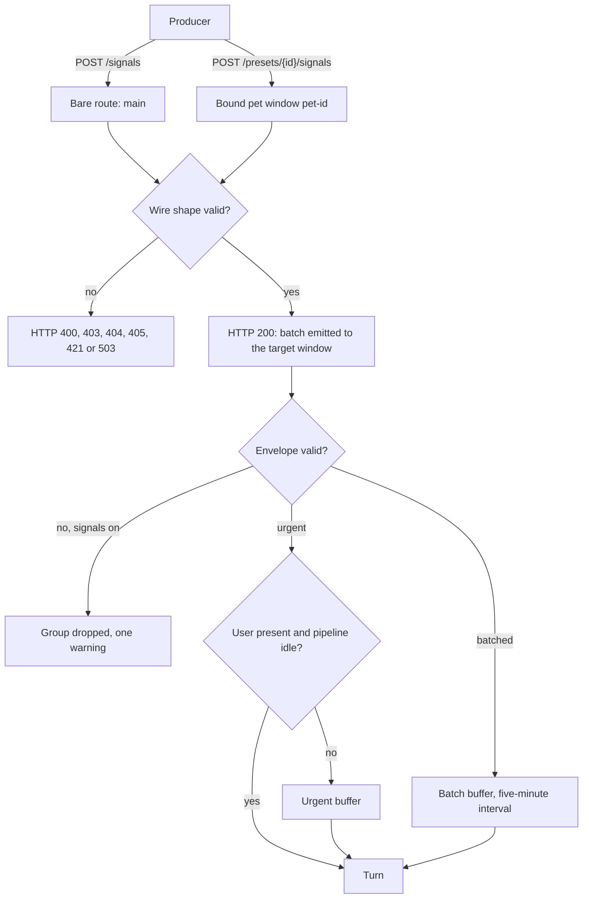
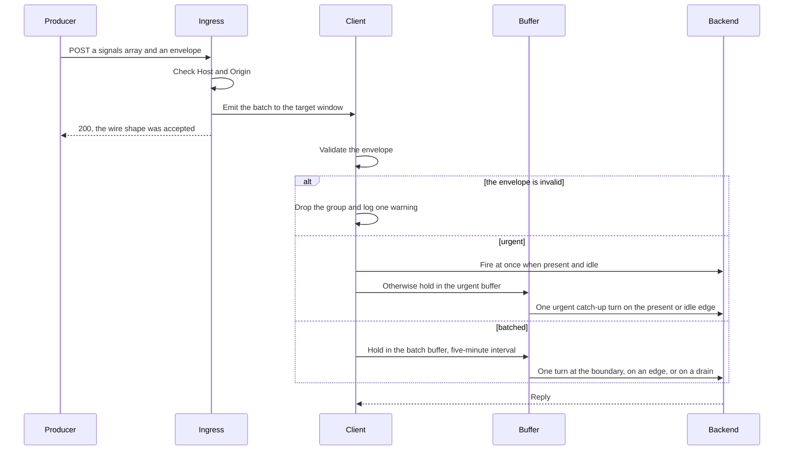

# Signals ingress

External producers send signal groups to the loopback HTTP ingress with `POST /signals`, and this page is the contract for that wire: the routes, the envelope fields, the two delivery classes, and the validation that accepts or refuses a request.

A backend author or agent reads it to build a producer the client accepts, and to know when the client turns a group into a turn.

The [producer guide](../guide/signals-producer.md) walks through writing a producer.





## The request

The ingress refuses a request whose `Host` is missing or not `127.0.0.1`, `localhost` or `::1` with 421, and a request whose `Origin` names another host with 403.

The request body contains a `signals` array and a delivery envelope:

```json
{
  "signals": [{ "kind": "workflow", "status": "complete" }],
  "envelope": {
    "source": "n8n",
    "event_type": "workflow_done",
    "delivery": "batched",
    "event_id": "run-8812",
    "occurred_at": 1787449000000
  }
}
```

Signal items are arbitrary opaque JSON values, and the client transports and renders them without
interpreting their meaning.

## Routes

One listener on one port serves every window, and the path chooses the recipient.

| Path | Recipient |
|---|---|
| `/signals` | `main`: the main window's character, whichever preset is active |
| `/avatar/state`, `/avatar/perch-targets`, `/avatar/command`, `/relations` | `main` |
| `/presets/<id>/signals` | `pet-<id>`: the pet window bound to preset `<id>`, and no other window |
| `/presets/<id>/avatar/state`, `/presets/<id>/avatar/perch-targets`, `/presets/<id>/avatar/command`, `/presets/<id>/relations` | `pet-<id>`; that window answers the request |
| any other path under `/presets/`, including a route name outside the routes above | none: HTTP 404 |
| an unknown path under `/avatar/` | none: HTTP 404 |
| any other unknown bare path | none: HTTP 400 |
| a preset id that exists while its pet window is closed | none: HTTP 503 |

### Preset ids

`<id>` is one path segment of ASCII letters, digits, `_` and `-`; the prefix itself, an id with no route after it, an empty id, and an id with any other byte all receive 404.

The listener is loopback-only and carries no authentication, so a local caller can tell which preset ids exist by the 404 and 503 replies; the ids are opaque keys, not secrets.

## Envelope fields

| Field | Valid value |
|---|---|
| `source` | Non-empty string identifying the producer |
| `event_type` | Non-empty string identifying the producer-defined event type |
| `delivery` | Exactly `"urgent"` or `"batched"` |
| `event_id` | Non-empty opaque string |
| `label` | Optional string: the producer's one-line origin |
| `occurred_at` | Finite epoch-millisecond number in the inclusive range `-8.64e15` through `8.64e15`, representable as an ISO-8601 date |

There is no fallback timestamp.

### The event_id field

A group replaces a buffered group with the same `event_id` in the same buffer, at its position, while a group with the same `event_id` in another buffer stays; a delivered group is not compared.

### The label field

The `label` is the producer's one-line origin, for example `devbox · tmux yui:2 · YUI (main)`. Over 120 code points it is cut to 119 code points plus `…` and the request is accepted; a non-string label makes the envelope invalid.

The label is not rendered in `client_context`; the client shows it, or `event_type` when it is absent, after `source` as the source line of the group on the speech bubble and in History. The bubble keeps the line to its own width and cuts the rest with an ellipsis, so the distinguishing words go first.

## Delivery

`delivery` names one of two delivery classes, `urgent` and `batched`; dropping is a producer-side rule, so a producer that wants a signal dropped does not send it.

### Urgent

An `urgent` group means the user should hear it now: it fires at once while the user is present and the pipeline is idle, and the proactive quiet gap does not hold it. Otherwise it waits in its own buffer, and on the away-to-present or busy-to-idle edge the buffered urgent groups fire together as one urgent catch-up turn.

On the return to present, the batch catch-up goes out first and the urgent catch-up is the next turn, right after it ends. Urgent groups never share a catch-up turn with `batched` groups, and the drains below carry batched groups only: a buffered urgent group keeps waiting for its own edge.

### Batched

A `batched` group always waits in the batch buffer, where the first group starts a five-minute delivery interval.

At the interval boundary, all pending batched groups fire together when signals are enabled, the user is present, and the pipeline is idle.

If those conditions are not met, the groups remain buffered without another timer, and a batched group that misses its deadline leaves on the next edge.

::: tip
A batched group that misses its deadline starts no second timer. It leaves on the next edge, or on a drain of the batch buffer.
:::

### Disabled signals

While signals are disabled, the client drops every group that arrives, and the next OS idle tick clears the groups already buffered.

### Catch-up and drains

Returning to present or transitioning from busy to idle emits one catch-up containing the batched groups in their original arrival order. Returning before a batched group's deadline therefore includes it in that catch-up.

Three client-fired turns also drain the buffers and carry the groups themselves: a `proactive.tap_bored` turn, the `time_milestone.first_activity` turn, and a `proactive.wake` turn that carries the day's first activity. Each takes every pending batched group in arrival order, and a drain empties the batch buffer.

### Groups that go back

A turn dropped before its backend call puts its groups back at the front of their buffers, and the next edge or drain delivers them. The drop comes from one of:

- the proactive quiet gap
- a guardrail
- the user's message while it waits
- a stale queue entry
- a degraded backend

A push the bus refuses, or a call that failed in transport or at the backend, also puts its groups back at the front of their buffers, and the next edge or drain delivers them. A turn the user's message cancels after its call started does not.

### Buffer and rate limits

Each buffer retains at most five groups and drops its oldest group on overflow.

Urgent turns are capped by their own hourly rate limit, `rate_limit.urgent_max` (default 120), and they do not count toward the tier-2 or overall caps; the cooldown the overall cap starts does not hold them.

## Relations

`GET /relations` and `GET /presets/<id>/relations` return the character's relation store: the relation the backend has rated toward the user and toward each other preset (`docs/reference/client-tools.md` § `rate_relation`). `PUT` on the same path replaces the whole store; that is how an external engine that keeps its own relationship record writes it.

```json
{
  "user": { "value": 5, "updated_at": 1787449000000,
            "log": [{ "at": 1787449000000, "delta": 2, "why": "asked how my day was before the bug" }] },
  "aaaa0001": { "value": -6, "updated_at": 1787430000000, "log": [],
                "note": "trusts the work, doubts the promises" }
}
```

### Store shape

One key per target: `user`, or another preset's id.

| Field | Valid value |
|---|---|
| `value` | Integer from -20 to 20 |
| `updated_at` | The epoch milliseconds of the last change |
| `log` | The last changes, newest first, at most 20, each `{at, delta, why}` with `delta` an integer from -40 to 40 other than 0 and `why` a string of at most 80 characters |
| `note` | Optional: an external engine's own summary of the relation, at most 200 characters |

A value the user sets by hand in the settings window logs one change with the full jump and the `why` `set by the user`.

The client never writes the `note`, and it renders the note on the `relation:` line after the band.

### Writes

A `PUT` body that is not an object, has a key that is neither `user` nor an existing preset id, or breaks any range receives HTTP 400 and leaves the store unchanged; a valid body answers 200 with the stored body.

A key for the window's own preset id is accepted, stored, and never rendered, and any other method receives 405.

The window renders the new relation on its next turn and in its preset row at once. The daily cap applies to the tool only; a `PUT` sets what it says.

## Preset switch

The bare routes belong to `main`: a group that arrives on `/signals` after the user switches presets becomes a turn of the newly active preset's backend, whichever backend the producer had in mind.

A route under `/presets/<id>/` belongs to that preset's window: its group becomes a turn of that preset's backend, which stays bound to `<id>` across a switch of the active preset.

Each pet window holds its own buffers, so a switch, which reloads `main`, drops every group still buffered there and leaves a bound window's buffers untouched.

## Validation

The HTTP ingress requires `POST /signals`, valid JSON, a `signals` array, and an `envelope`.

### Refusals

A request with another method on `/signals` or `/presets/<id>/signals` receives HTTP 405, and invalid JSON, a missing `signals` array, or an absent or null `envelope` receives HTTP 400.

A request under `/presets/` whose id no preset has, or whose path after the id is none of the routes above, receives HTTP 404. An unknown path under `/avatar/` receives HTTP 404; any other unknown bare path receives HTTP 400.

A request for a preset id that exists while its pet window is not open receives HTTP 503; it is never passed to `main`.

### What 200 means

HTTP 200 means that the ingress accepted the wire shape and attempted to emit the batch to its target window; it does not confirm receipt or delivery. The envelope is forwarded unchanged and stamped with server time.

::: warning
A 200 answers the wire shape only. The batch can still lose a group after it: while signals are enabled, an invalid envelope is dropped as a whole, and one warning records the item count.
:::

### Dropped envelopes

While signals are enabled, a group whose envelope is not an object or fails the field rules is dropped as a whole and one warning is logged with the item count. While signals are disabled, the source drops incoming batches before envelope validation and logs no envelope warning.

### Size limits

A request with any signal item whose JSON serialization exceeds 16 KiB receives HTTP 400; no item of that request is delivered. A request body over 64 KiB receives HTTP 400.
