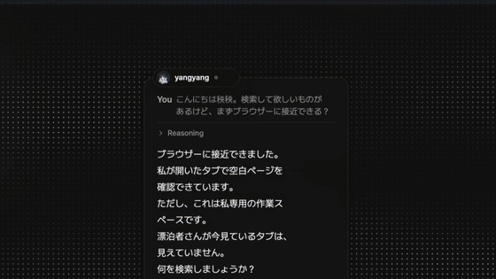

# Plugins

A plugin gives YUI's characters something new to do: a tool her brain can call, or a way for the outside world to reach her. The official ones live in this folder. Plugins for Claude Code and Codex are in [Coding agents](../coding-agents/README.md).

| Plugin | What it does | How you get it |
| --- | --- | --- |
| [browser](browser/README.md) | She searches the web and opens pages in ego lite, then tells you what she found. | Installed from the Catalog on YUI's **Plugins** page |
| [herdr](herdr/README.md) | She watches your coding agents in herdr panes and answers their questions, here and on saved SSH machines. | Added from a folder on YUI's **Plugins** page until its first release puts it in the Catalog |

## She looks things up in your browser

Install the official `browser` plugin from the [Plugins page](../docs/guide/plugins.md) and turn it on. Then she searches the web, opens pages in ego lite, and tells you what she found. ego lite is the only supported browser, and it must be installed and run once first.

While the plugin is on, a script runs with your rights and can read your files, run programs, and reach every site signed in on ego lite's YUI profile.

## She watches your coding agents

Install [herdr](https://herdr.dev) and start it once. Build the plugin with `cargo build --release` in `plugins/herdr`, copy `target/release/herdr` to `plugins/herdr/bin/herdr`, add the `plugins/herdr` folder with **Add from folder…** on the [Plugins page](../docs/guide/plugins.md), and turn it on. Then she hears when an agent finishes or waits on a question, here and on every enabled herdr machine, and can read and answer it.

While the plugin is on, the backend can type into your coding-agent sessions on every watched machine with your rights: submit prompts and send key presses.

## Make your own

- [Plugins](../docs/guide/plugins.md): install, turn on, and allow a plugin.
- [Write a plugin](../docs/guide/write-a-plugin.md): give a character new MCP tools or skills.
- [Contribute a plugin](../docs/guide/contribute-a-plugin.md): list yours in the Catalog or ship it in this repository.
