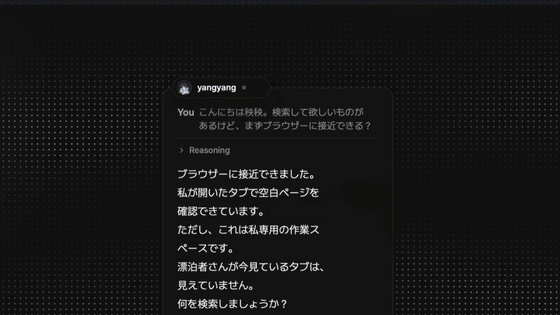

# Plugins

A plugin gives YUI's characters something new to do: a tool her brain can call, or a way for the outside world to reach her. The official ones live in this folder.

| Plugin | What it does | How you get it |
| --- | --- | --- |
| [browser](browser/README.md) | She searches the web and opens pages in ego lite, then tells you what she found. | Installed from the Catalog on YUI's **Plugins** page |
| [yui-notify](yui-notify/README.md) | Claude Code and Codex conversations arrive in YUI as Threads you read and answer. | Installed into Claude Code or Codex from the `yui` marketplace |
| [factorio](factorio/README.md) | Bridges the Factorio game to her brain, so she reacts to what happens in your factory. | Run it yourself on the machine that runs Factorio; your backend agent connects to it. |

## She looks things up in your browser

Install the official `browser` plugin from the [Plugins page](../docs/guide/plugins.md) and turn it on. Then she searches the web, opens pages in ego lite, and tells you what she found. ego lite is the only supported browser, and it must be installed and run once first.

While the plugin is on, a script runs with your rights and can read your files, run programs, and reach every site signed in on ego lite's YUI profile.

## Read your coding agent's Threads

The [yui-notify](yui-notify/README.md) plugin posts Claude Code and Codex conversations as Threads. A Thread does not make a character speak. You answer them in YUI's Threads window.

Codex takes answers through synchronous hooks. Claude Code takes them through its own inbox socket, with no launch flag.

Turn on **External signals** in **Settings → Proactive → Watchers**, then restart YUI.

## Make your own

- [Plugins](../docs/guide/plugins.md): install, turn on, and allow a plugin.
- [Write a plugin](../docs/guide/write-a-plugin.md): give a character new MCP tools or skills.
- [Contribute a plugin](../docs/guide/contribute-a-plugin.md): list yours in the Catalog or ship it in this repository.
